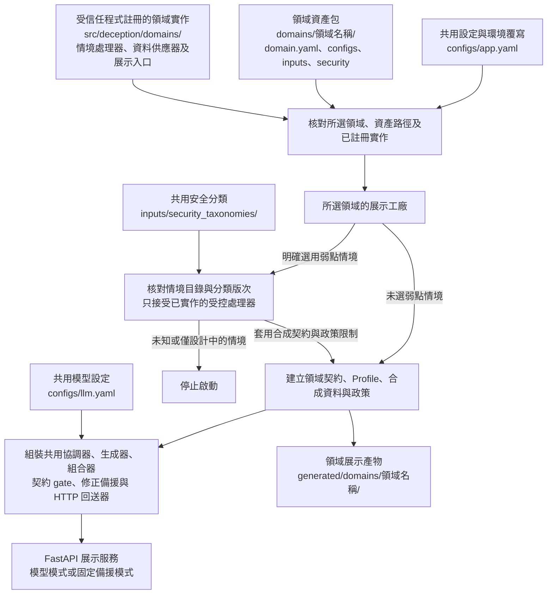
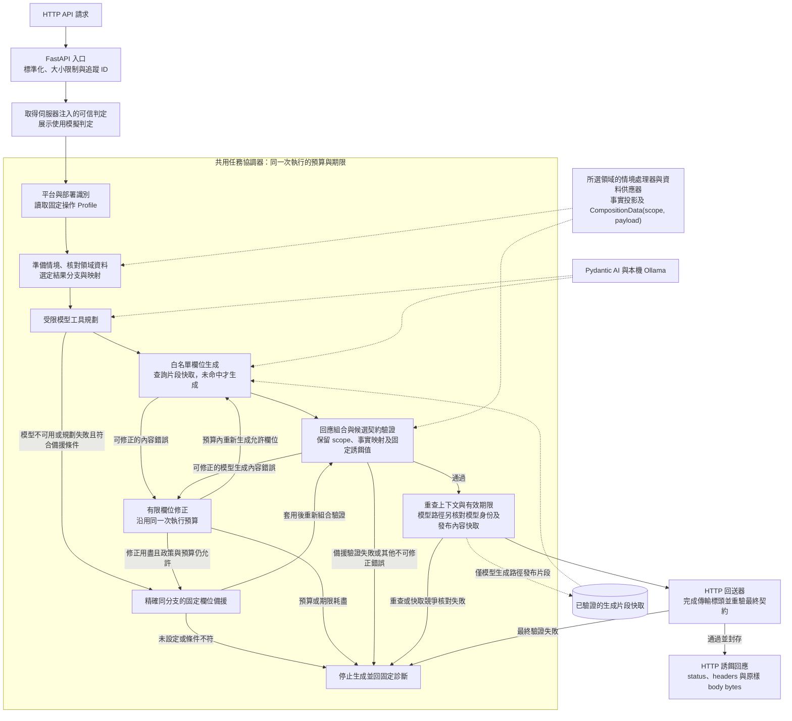

# Mirage_API — 通用型 API 誘餌平台

Mirage_API 接收外部系統的可信攻擊判定，依目標服務契約、領域規則與合成資料生成誘餌回應，通過驗證後以 FastAPI 回送。核心流程共用；各領域的業務資訊、資料型別、來源與弱點情境各自維護。

目前內建領域為 `ecommerce`。電商設定與資料集中在 [domains/ecommerce](domains/ecommerce/README.md)，商品處理程式位於 `src/deception/domains/ecommerce/`。新增領域須提供資料供應器、情境處理器、契約、驗證器及文件，並由受信任程式明確註冊。測試另以非電商工單驗證共用流程，尚未提供正式工單領域包。

各工具的輸入、輸出、用法、失敗處理、驗證與授權見 [工具文件索引](docs/README.md)。

## 系統架構

本次拆分新增了明確的領域選擇、領域資產包、領域實作註冊表及共用資料交換介面；OWASP 分類由核心共用，各領域自行維護弱點情境。下列兩張圖分別呈現啟動組裝與每次請求的處理流程。

### 領域載入與啟動組裝

此圖對應共用展示入口 `deception.api.demo:create_app`。正式部署也可由自己的組裝程式建立元件，再注入 `deception.api.pipeline.create_app`。



弱點情境在啟動時由管理者選定。展示工廠先把固定誘餌值及必要標頭等限制加入合成契約，再建立規格摘要與 Profile，並將固定值套入相應政策；目前沒有依訪客請求自動偵測 OWASP 類別或切換弱點的功能。未知領域、資產越界及不符設定也會停止啟動。

### 每次請求的生成與回送

下圖呈現完整 HTTP 接入的共用流程。虛線表示領域供應器、模型服務或內容快取的資料依賴；外部系統的來源認證由部署整合負責，隔離展示則明確注入 `simulated_malicious` 模擬判定。



組合器接收領域供應器已核對的 `CompositionData`，不限定商品或變體根節點。快取只保存生成片段，命中時仍須經過本次身份、情境、模型規劃及回應驗證；發布競爭若取得另一份勝出值，會重新組合並驗證。固定備援不寫入模型內容快取，也必須通過相同的組合、契約及最終 HTTP 驗證。

圖中修正僅處理允許的生成欄位；模型不可用或規劃失敗時，符合條件才直接選固定備援，不進入欄位重新生成迴圈。來源、身份、HTTP metadata、資料、判定關聯或期限不符時會停止，不能透過修正或備援放行。部署代理接入、遠端判定來源認證、集中設定及交易狀態更新仍列於下方「驗證與目前邊界」，未畫成已實作元件。

## 快速使用

在專案根目錄執行：

```powershell
docker compose up --build -d --wait --wait-timeout 180
curl.exe http://127.0.0.1:8000/healthz
curl.exe http://127.0.0.1:8000/demo/info
docker compose exec mirage python tools/verify_domain_api.py --domain ecommerce --base-url http://127.0.0.1:8000
```

預設使用固定文字備援，無需啟動模型。完整 input、呼叫範例、模型模式、持久化與部署方式見 [Docker 說明](docs/docker.md)；商品 API 範例及驗證矩陣見 [電商使用說明](domains/ecommerce/docs/usage.md)。容器預設只發布本機連接埠。

目前工作環境沒有 Docker 引擎；Dockerfile、Compose 與封裝流程已提供，容器實際建置／啟動仍需在具備 Docker 的環境執行。原生 HTTP 驗證與單元測試不能替代容器測試。

## 領域選擇與資料夾

`configs/app.yaml` 明確指定使用領域：

```yaml
schema_version: 1
domain: ecommerce
domains_dir: domains
```

可用 `MIRAGE_APP_CONFIG` 指定另一份設定，或以 `MIRAGE_DOMAIN`、`MIRAGE_DOMAINS_DIR` 覆寫選擇。未知領域、缺少實作、路徑越界及不符 manifest 的資產會停止載入。

```text
configs/
  app.yaml                         # 共用領域選擇
  llm.yaml                         # 共用模型設定
inputs/security_taxonomies/        # 版本化 OWASP 分類
  owasp-api-security-2023.yaml
  owasp-web-2025.yaml
domains/
  ecommerce/
    domain.yaml                    # 電商資產位置
    configs/                       # 展示、部署、生成與組合設定
    inputs/                        # 來源、平台、政策、情境及測試輸入
    security/owasp-scenarios.yaml   # 電商弱點設計及實作狀態
    docs/                          # 電商用法、來源稽核與驗證紀錄
src/deception/
  common/                          # 共用嚴格型別、scope 與資料交換
  domains/ecommerce/               # 商品模型、資料供應器及專用展示
  security/                        # 分類與情境目錄驗證
  api/                             # 共用 FastAPI 入口及領域派送
  discovery/                       # 部署與契約識別
  profile_builder/                 # 固定來源規格與操作摘要
  scenarios/                       # 共用情境引擎與領域介面
  llm/                             # 模型選擇、受控工具及執行預算
  generation/                      # 白名單欄位生成與快取
  core/                            # 協調、組合、修正、驗證與 HTTP 回送
generated/domains/<domain>/        # 隔離的展示產物與驗證報告
tests/
```

共用資料以 `CompositionData(scope, payload)` 傳遞。領域供應器先驗證業務資料，再投影允許映射的 JSON；共用組合器不定義商品欄位。舊 `deception.synthetic` 等匯入路徑保留相容轉出，新實作只有一份。詳見 [領域擴充介面](docs/domains.md) 與 [共用資料交換](docs/common-data.md)。

## 根據 OWASP 設計弱點情境

共用分類採用 [OWASP API Security Top 10 2023](https://api-security.owasp.org/editions/2023/en/0x11-t10/) 與 [OWASP Web Top 10 2025](https://top10.owasp.org/2025/0x00_2025-Introduction/)，保留正式分類 ID 及版次。各領域依適用風險設計自己的誘餌情境與驗證條件；不假設每個產業都有官方專屬 Top 10，跨分類對應是本專案設計。

```powershell
$env:PYTHONPATH = "$PWD/src"
.\.venv\Scripts\python.exe -m deception.domains --list-domains
.\.venv\Scripts\python.exe -m deception.domains --domain ecommerce
```

電商目錄已列出 10 個 API 風險情境，目前兩項可選：

| 情境 ID | 回應行為 | 對應風險 |
| --- | --- | --- |
| `api3-internal-product-properties` | 商品回應包含固定的虛構內部備註 | API3:2023；A01:2025 |
| `api8-debug-header-disclosure` | 回應帶固定虛構舊版系統標頭 | API8:2023；A02:2025 |

在 `domains/ecommerce/configs/demo.yaml` 設定 `weakness_scenario` 選擇；預設 `null`。重啟服務後 `/demo/info` 會顯示啟用情境。剩餘八項標為 `designed`，啟用時會拒絕。這兩項模擬只輸出合成資料，仍經固定欄位保護與契約驗證；沒有執行 SQL、系統命令、任意外連或開放主機權限。詳見 [分類、設計及驗證說明](docs/owasp-design.md)。

## 元件目的與處理流程

| 元件 | 功能及目的 |
| --- | --- |
| HTTP 請求入口 | 保留 method、URL、重複標頭、原始 body 與追蹤 ID，限制請求大小 |
| 平台識別 | 依可信部署綁定選定站點、平台、版本及規格雜湊 |
| Profile 工具 | 從固定來源建置操作摘要，精確取得 method、path、status 與 schema |
| 領域供應器與情境引擎 | 驗證合成事實及可信判定，選擇明確業務分支與映射 |
| 任務協調器與模型工具 | 在共用預算內調用受限工具及本機模型 |
| 內容生成器 | 只生成政策允許的欄位，保護事實映射與固定值，按上下文快取 |
| 回應組合與契約 gate | 組合完整候選，以選定 OpenAPI 契約驗證結構及 HTTP metadata |
| 修正與備援 | 有限重新生成或使用精確同分支備援，再次驗證 |
| HTTP 回送器 | 重驗最終傳輸候選，回送原始 body bytes、狀態與標頭 |

`deception.api.demo:create_app` 是依領域派送的隔離展示入口，使用合成契約及模擬惡意判定。正式整合由 `deception.api.pipeline.create_app` 注入可信判定 provider 與部署設定。單獨的 `deception.api.app:app` 及僅平台識別入口維持診斷用途，不會自動生成完整回應。

預設本機模型為 `hf.co/fdtn-ai/Foundation-Sec-8B-Reasoning-Q4_K_M-GGUF:Q4_K_M`，可列出及選擇已安裝的精確模型，不會自動下載。模型模式、遠端主機透過受控隧道連接本機 Ollama、權重與 tokenizer 條款見 [模型工具](docs/llm.md) 及 [協調與生成](docs/orchestration.md)。

## 驗證與目前邊界

需要 Python 3.11+，在專案根目錄執行：

```powershell
python -m venv .venv
.\.venv\Scripts\python.exe -m pip install -e ".[test]"
.\.venv\Scripts\python.exe -m pytest -q
.\.venv\Scripts\python.exe tools/check_documentation.py
$env:PYTHONPATH = "$PWD/src"
.\.venv\Scripts\python.exe -m uvicorn deception.api.demo:create_app --factory --host 127.0.0.1 --port 8000 --no-proxy-headers
```

另一個終端機執行：

```powershell
.\.venv\Scripts\python.exe tools/verify_domain_api.py --domain ecommerce --base-url http://127.0.0.1:8000
```

HTTP 驗證器執行 16 個一般及攻擊特徵請求，檢查 `200 → 404 → 200`、不同商品隔離、提示與標頭注入、未支援寫入及快照不變；預設報告為 `generated/domains/ecommerce/verification/http-api.json`。單元測試另覆蓋兩個弱點模擬、錯誤設定拒絕，以及非電商工單完整協調、生成、契約驗證與回送。歷史本機 Foundation 模型證據與限制見 [電商驗證紀錄](domains/ecommerce/docs/verification.md)。

目前合成資料為唯讀快照，購買、扣款、庫存更新與 session 交易隔離尚未提供。遠端可信判定來源認證、各部署的代理接入、集中設定服務及真實部署對照仍待實作。平台版本、來源核准狀態與稽核紀錄全部留在 [電商領域文件](domains/ecommerce/README.md)。

其他入口、驗證 API input 及故障處理見 [HTTP 入口](docs/ingress.md)、[平台識別](docs/identifier.md) 及 [契約驗證](docs/gate.md)。所有具名函式、測試與輔助程式都須有功能 docstring，並由文件檢查確認。

## 開源軟體、模型與資料授權

以下按本 repo 的 `pyproject.toml` 和上游授權資料區分。**採用**是現有直接依賴，**規劃／可選**未集成，**未採用**沒有引入。連結指向上游授權或官方資料；發行前仍須按實際鎖定版本及間接依賴逐項核對。

| 類別 | 專案 | 上游授權／來源 | 用途與界線 |
| --- | --- | --- | --- |
| 採用 | [FastAPI](https://github.com/fastapi/fastapi/blob/master/LICENSE) | MIT | 驗證 API、HTTP 請求入口原始入口及可選完整 HTTP app |
| 採用 | [Uvicorn](https://github.com/Kludex/uvicorn/blob/main/LICENSE.md) | BSD-3-Clause | FastAPI 的 ASGI 執行服務 |
| 測試採用 | [pytest](https://github.com/pytest-dev/pytest/blob/8.4.2/LICENSE)／[HTTPX](https://github.com/encode/httpx/blob/0.28.1/LICENSE.md) | MIT／BSD-3-Clause | 單元、整合測試與測試 HTTP client |
| 採用分類資料 | [OWASP API Security](https://github.com/OWASP/API-Security/blob/master/LICENSE)／[OWASP Top 10](https://github.com/OWASP/Top10/blob/master/LICENSE) | CC-BY-SA-4.0 | 分類 ID／名稱及本專案中文翻譯；出處、修改與共享條款見 [分類文件](docs/owasp-design.md)，未引入漏洞執行程式 |
| 採用既有間接依賴 | [Starlette](https://github.com/Kludex/starlette/blob/main/LICENSE.md) | BSD-3-Clause | FastAPI 的 ASGI 基礎；HTTP 回送器原始 bytes／headers 回送，未新增套件 |
| 採用 | [Pydantic](https://github.com/pydantic/pydantic/blob/main/LICENSE) | MIT | 嚴格輸入／輸出模型與情境選擇工具白名單政策 |
| 採用 | [openapi-core](https://github.com/python-openapi/openapi-core/blob/master/LICENSE) | BSD-3-Clause | 正式 OpenAPI 驗證；保留版權、授權與免責聲明，不用作者名稱背書 |
| 採用 | [Werkzeug](https://github.com/pallets/werkzeug/blob/3.1.1/LICENSE.txt) | BSD-3-Clause | 回應組合與契約驗證的 HTTP headers adapter |
| 採用 | [PyYAML](https://github.com/yaml/pyyaml/blob/6.0.3/LICENSE) | MIT | 來源、Profile、情境選擇工具政策與組合指令讀取 |
| 採用 | [jsonschema](https://github.com/python-jsonschema/jsonschema/blob/main/COPYING) | MIT | PoC 自訂契約及既有 OpenAPI 驗證依賴鏈；不代替網站部署 gate |
| 使用的外部程式 | [Ollama](https://github.com/ollama/ollama/blob/main/LICENSE) | MIT，限此**程式碼** | 任務協調與內容生成連接的本機推論服務；模型權重有各自條款，不能從 Ollama 授權推定模型可商用或再散布 |
| 採用 | [Pydantic AI](https://github.com/pydantic/pydantic-ai/blob/v2.66.0/LICENSE) | MIT | `pydantic-ai-slim[openai]==2.66.0`，任務協調器的工具規劃與內容生成器的結構輸出；相容 client 連接本機 Ollama，主要間接依賴授權見 [任務協調與內容生成說明](docs/orchestration.md#套件模型與資料授權) |
| 僅參考 | [Galah](https://github.com/0x4D31/galah/blob/main/LICENSE) | Apache-2.0 | 參考公開提示、生成與快取設計；未引入 Go runtime 或複製程式碼 |
| 採用 | [Faker](https://faker.readthedocs.io/en/stable/#license) | MIT | 合成資料工具的商品文字生成；鎖定 40.44.0，使用獨立 instance seed |
| 可選 | [Prism](https://github.com/stoplightio/prism/blob/main/LICENSE) | Apache-2.0 | 外部 mock 比對，不是現有回應組合與契約驗證 |
| 可選 | [Schemathesis](https://github.com/schemathesis/schemathesis/blob/master/LICENSE) | MIT | 契約測試；通過仍不等於官方行為一致 |
| 未採用 | [WireMock](https://github.com/wiremock/wiremock/blob/master/LICENSE.txt) | Apache-2.0 | 可作替代 mock server；目前無依賴 |
| 未採用 | [Tenacity](https://github.com/jd/tenacity/blob/main/LICENSE) | Apache-2.0 | 修正與備援工具評估過的通用有限重試元件；沿用主機共用預算與既有模型介面，未加入依賴 |
| 參考資料 | [WooCommerce REST API 文件](https://developer.woocommerce.com/docs/apis/rest-api/v3/products/)／[外掛授權標示](https://github.com/woocommerce/woocommerce/blob/trunk/plugins/woocommerce/readme.txt) | 文件、程式碼與範例權利須分開核對；外掛標示 GPLv3+ | 僅參考 API 行為，未複製其程式碼。閱讀 GPL 專案文件不會使獨立實作自動受 GPL 約束；若複製程式碼或大量文件，須另評估 |
| 參考資料 | [Medusa Store API 文件](https://docs.medusajs.com/api/store)／[核心授權](https://github.com/medusajs/medusa/blob/develop/LICENSE) | 核心儲存庫除企業版材料外為 MIT；企業版另有條款 | 現有子集已依官方固定 commit 核實核心結構並修正；實際部署尚未對照，規格與文件的再散布權仍須逐項核對 |

`pyproject.toml` 還列有 `uvicorn`、`PyYAML`、`werkzeug`、`Faker==40.44.0`，測試 extra 有 `pytest`、`httpx`；它們及**間接依賴**（例如 Faker 安裝帶入的 `tzdata`）也須按實際解析出的版本納入第三方清單。合成資料工具只使用 Faker 的公開 API，不複製其原始碼或資料。Polyfactory 與 hypothesis-jsonschema 僅是評估過、未安裝的候選。上表不是完整 SBOM，也未替 Mirage_API 原始碼選定授權；目前根目錄沒有 `LICENSE`，不可暗示本專案已用某種開源授權發布。

內部執行與提供軟體、容器、模型或規格給他人，所涉義務可能不同。分發時依實際包含元件保存 MIT／BSD／Apache 等授權與版權聲明；Apache-2.0 元件若帶 `NOTICE`，按條款保留適用內容並標示修改。README 簡表不能替代授權檔與 NOTICE。另核對模型權重的使用／商用／再散布條款，以及下載或打包的 API 規格、範例、文件的個別權利。不要把「依賴某個 LGPL／GPL 程式」直接等同整個獨立專案必須改用該授權；若未來引入其程式碼或連結／分發該元件，按**具體版本、整合方式與分發形式**評估並履行義務。
