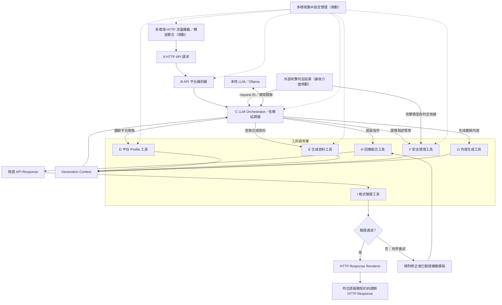

# Mirage_API — Universal LLM-driven API Deception Platform

**跨環境、跨框架、可擴充的 API 誘餌回應生成平台。**

Mirage_API 的製作目標是整合不同部署環境的 HTTP 流量入口，接收外部系統提供的攻擊判定結果，依目標 Web 服務的 API 契約、虛構資料及互動狀態，使用本地 LLM 動態生成誘餌回應，並在驗證後輸出符合原服務契約的 HTTP Response。多個部署環境及其設定由集中管理能力統一維護。

電商是初期驗證案例，範圍包含 Medusa（測試目標 `v2.22.4`）與 WooCommerce；整體平台的設計目標涵蓋其他 Web 服務、應用框架與部署方式。F 以 `domain: ecommerce` 選擇電商領域；此處的「Platform」表示該領域下的目標服務及其契約、版本與部署設定。領域可透過型別化政策及處理器擴充，目前內建可用領域只有電商。

## 核心能力與目前進度

以下七項是平台的製作目標；進度以本 repository 的實作為準。

1. **多環境 HTTP 流量攔截整合**：透過部署環境的代理、閘道或應用程式整合介面，將指定流量導入統一入口，保留原服務識別與請求資訊。
2. **接收外部攻擊判定結果**：取得外部偵測器提供的判定、攻擊類型與證據摘要，與原請求關聯，作為誘餌情境及生成策略的輸入。攻擊偵測由外部系統負責。
3. **根據不同 Web 服務的 API 契約生成誘餌回應**：依服務、操作、版本、狀態碼、媒體類型及 schema 選擇生成約束，透過 Profile 與服務對映擴充支援範圍。
4. **維護跨 API 的虛構資料及互動狀態**：讓同一互動中的列表、明細與後續操作引用相同實體，並在允許的操作後更新虛構狀態；不同環境與互動彼此隔離。
5. **使用本地 LLM 動態生成回應**：由協調器調用本地模型與受限工具，根據契約、外部判定、情境及虛構狀態生成內容。
6. **輸出符合原服務契約的 HTTP Response**：組合 status、headers 與 body，通過對應契約驗證後渲染；失敗時執行有界修正或再次驗證備援。
7. **集中管理多個部署環境及其設定**：統一維護環境、部署、服務、契約、Profile、生成策略與模型設定的關聯和版本，供各環境取得適用設定。

| 核心能力 | 已有基礎 | 尚待完成 |
| --- | --- | --- |
| 多環境流量攔截整合 | A：FastAPI HTTP 入口；B：明確環境／部署綁定識別及可選 A→B 接入 | 各環境流量攔截／轉送接入、可信代理與統一轉接介面 |
| 外部攻擊判定接收 | A 保留 request ID；F 已有判定模型、時效／請求關聯及情境選擇 | 判定接收器、來源認證與完整流程串接 |
| 依多服務契約生成 | B：唯一契約與操作識別；D：固定 OpenAPI 的 Profile；H：候選組合；I：契約驗證 | C/G 生成、完整流程串接、更多服務對映 |
| 跨 API 虛構資料與互動狀態 | E：可重現、可查詢的商品／變體資料與關聯 | 跨請求狀態更新、寫入操作、互動／session 隔離與並行一致性 |
| 本地 LLM 動態生成 | 圖中的 C、G、P 與其資料邊界已規劃 | Ollama 整合、模型選定、工具調用與生成流程 |
| 契約一致的 HTTP 輸出 | H：候選組合及契約 preflight；I：獨立驗證 API | M、修正／備援，以及入口到輸出的完整串接 |
| 多環境集中管理 | 本地來源／生成設定、B 部署 binding 與可信 runtime context | 集中設定儲存、管理介面、版本發布與代理整合 |

目前 A、B、D、E、F、H、I 可各自使用，也有可選的 A→B 入口；B 識別成功後仍回 `501 orchestrator_not_implemented`，因 C 尚未接上。原始 A 入口預設仍回 `501 pipeline_not_implemented`。F 可明確選擇電商領域，再依同一 E 快照選商品存在／不存在分支，交給 H 組合，再由 I 驗證；共用引擎與領域處理器已分開，尚未接上正式 HTTP 主流程或圖形選擇介面。現有 E 是可查詢的固定資料快照，尚不提供互動造成的狀態更新。本文所有「規劃」格式只定義預期介面，不能當作現有 API 使用。

## 系統架構與整合邊界

下圖保留 A–O 的生成與驗證主流程，補上環境流量整合、外部攻擊判定及集中設定管理。新增的整合能力均為規劃；虛線表示設定供給。



跨環境的整合層負責流量導入與回送，服務 Profile 負責契約差異，C–I 的核心流程使用一致的內部資料介面。擴充某個應用框架或部署環境時，應增加對應的轉接與設定，維持核心生成流程共用。目前 FastAPI 是 Mirage_API 自身的入口框架，目標服務可採用其他框架；具體框架的相容性仍需逐一驗證。

外部判定須與 `request_id`、環境及服務身份關聯。判定本身用來選擇情境和策略，不能取代 API 契約或放寬驗證規則。F 會拒絕缺少、未知、過期或與請求不符的判定；來源白名單並不是來源認證。接收層的認證、事件去重及流量導向仍待實作，不能把任意用戶端 header 直接當作可信攻擊判定。

集中管理屬於設定管理能力：預期將環境、部署、服務版本、契約雜湊、Profile、情境、生成策略與模型設定綁定成可追溯的設定版本。請求處理使用確定的一份設定，避免執行中混用不同版本。目前只有本地檔案與工具，尚無集中管理服務。

「合成」表示平台維護的虛構資料；初期例子使用商品與變體。契約通過只證明符合**已載入、適用於該服務和版本的規格**，不能單憑此聲稱與官方服務所有行為一致。請只在獲授權的測試環境使用，不要把真實憑證或顧客個資放入提示或樣本。

## 模組、輸入輸出與調用關係

| 節點 | 輸入 → 職責 → 輸出 | 狀態 |
| --- | --- | --- |
| A HTTP API 請求 | method、URL、headers、body → 保留原始 URL、query、追蹤 ID 的標準化請求；未來由環境轉接層提供部署上下文 | **已實作**：`deception.api.app:app`；保留重複 query／headers 與 body bytes，尚未接上 B/C，預設回 501 |
| B 平台識別器 | 環境／部署／服務綁定、origin、API 前綴、method、path、版本 → 唯一平台與 operation；不明時拒絕猜測 | **已實作**：`src/deception/discovery/`；與 I 共用匹配器，可接 A／D；代理整合與集中設定管理尚未實作 |
| C 任務協調器與 P Ollama | 識別結果、外部攻擊判定、生成策略 → 向 D–G 取材、限制 LLM 工具與輪次、指示 H；Ollama 提供本地推論 | 未實作；未選定模型 |
| D 平台 Profile 工具 | 固定來源與 OpenAPI → 可追溯的操作、參數、狀態碼、媒體類型、schema 上下文 | **已實作**：`src/deception/profile_builder/`；提供 CLI 建立及 Python 查詢，尚未接上 C；不推測平台慣例 |
| E 合成資料工具 | 種子、隔離身份、資料規則 → 跨操作可引用的虛構實體；未來維護互動造成的狀態變更 | **已實作**：`src/deception/synthetic/` 的商品／變體生成、保存、驗證與只讀查詢；顧客、訂單及互動狀態更新尚未實作 |
| F 安全情境工具 | 領域政策、可信整合層的判定、白名單與 B/D → 固定 family；領域處理器再依資料選分支與 H 計畫 | **已實作**：`src/deception/scenarios/`；可選 `ecommerce`，提供 GET 商品 200／404、可追溯決策及交接完整性；領域可註冊擴充，尚無其他真實領域資料，不偵測攻擊或更新交易狀態，詳見 [F 功能、驗證與授權](docs/scenarios.md) |
| G 內容生成工具 | Profile、合成資料、情境、模型提示 → 動態文字與欄位候選 | 未實作 |
| J Generation Context | D–G 的資料及來源 → 交回 C，記錄環境／部署／服務身份、判定關聯、契約版本、種子、情境及狀態版本 | 未實作 |
| H 回應組合工具 | 明確指令、D 契約、可選 E 映射 → status、headers、已序列化 body | **已實作**：`src/deception/core/`；UTF-8 JSON、嚴格 metadata 與契約 preflight，產物仍需 I 驗證；C/J 尚未串接 |
| I 格式驗證工具 | 候選 status、headers、body 及原請求 URL／method → `pass`、`reject` 或 `unverifiable` 與錯誤 | **已實作** |
| N 修正或備援 | 驗證錯誤 → 有上限的重新組合；耗盡後用同一契約已驗證的備援 | 未實作；現有驗證器不修正、不重試、不提供備援 |
| M HTTP Response Renderer | 僅接收 `pass` 且 `valid=true` 的同一份回應 → HTTP status、headers、body | 未實作 |

A → B → C；C 關聯外部攻擊判定，分別調用 D/E/F/G，匯成 J，再指示 H 建立 K；I 驗證 K。`reject` 可按錯誤碼做**固定上限**的修正，每次重新驗證。`unverifiable` 表示缺少可信契約或情境，不應由 LLM 補出規格。備援也必須通過 I，否則失敗關閉。重試上限、超時和對外失敗狀態碼仍待設計。通過後 M 必須渲染**完全相同**的 body、status、headers，不得再改動。

規劃中的跨 API 互動應共用明確的虛構實體與狀態版本。例如建立一筆虛構資源後，列表與明細 API 應能讀到相同 ID 與欄位，後續更新及刪除也應反映在同一互動中。狀態寫入需配合契約驗證、並行控制與重試去重，避免修正一次回應就重複建立資源；目前尚無這類狀態寫入流程。

## 檔案與輸入資料

核心流程預期使用下列六類輸入；外部判定與部署上下文由整合層補入。檔案存在與模組實際載入的狀態需分別確認。

| 輸入 | 內容與用途 | 目前對應 |
| --- | --- | --- |
| HTTP Request | 原始 method、URL、query、headers、body 與追蹤 ID | A 的 `NormalizedRequest` 已實作 |
| API Specification | 固定版本的操作、參數、狀態碼、headers 與回應 schema | D 的 `inputs/sources/`；I 另讀 `inputs/platforms/` 的部署契約 |
| Platform Profile | 服務版本、契約來源、operation 摘要及生成上下文 | D 已建立 `generated/profiles/`；完整服務慣例與回應對映仍待擴充 |
| Scenario Configuration | 領域、情境白名單、適用操作及外部判定的情境選擇規則 | F 讀取 `inputs/policies/deception.yaml` 格式，必填 `domain: ecommerce`；現有 `inputs/scenarios/` 草稿不自動載入 |
| Synthetic State | 跨 API 共用的虛構實體、關聯與互動狀態 | E 已有商品／變體快照；狀態更新尚未實作 |
| Generation Policy | 模型、工具權限、生成限制、修正上限與備援策略 | 策略草稿未串接；`configs/generation.yaml` 目前只管理 E 的資料生成規則 |
| 外部攻擊判定 | 與請求關聯的攻擊標籤、來源與判定依據 | F 已有嚴格模型與關聯檢查；接收及來源認證介面待實作 |
| 部署與環境設定 | 環境／部署／服務綁定及本次使用的設定版本 | 本地設定可供個別工具使用；集中管理待實作 |

```text
Mirage_API/
├─ README.md
├─ pyproject.toml                    # 現有驗證器依賴及測試設定
├─ .env.example                      # MIRAGE_PLATFORMS_DIR 設定提示
├─ src/deception/api/               # A：FastAPI 原生請求入口與標準化介面
├─ src/deception/discovery/         # B：明確部署綁定、唯一契約與操作識別
├─ src/deception/profile_builder/   # D：來源檢查、Profile 建立與操作查詢
├─ src/deception/synthetic/         # E：合成商品、變體、資料關聯與有效性驗證
├─ src/deception/scenarios/         # F：共用引擎、領域註冊、情境與 H 計畫
│  └─ domains/ecommerce.py          # 電商政策、商品規則及 prepare／resolve 處理器
├─ src/deception/core/              # H：明確模板、E 映射與候選回應組合
├─ configs/generation.yaml          # E：隔離身份、種子、數量與生成規則
├─ configs/composition.yaml         # H：明確狀態、headers、body 與映射指令
├─ configs/bindings.yaml            # B：環境／部署／站點與固定契約綁定
├─ inputs/sources/                  # D：source.yaml 與固定 OpenAPI 輸入
├─ inputs/policies/deception.yaml    # F：停用的部署／情境政策範本
├─ generated/                       # D/E/F/H：profiles、schemas、synthetic_data、scenarios、responses
├─ mirage_validator/                 # 已實作的驗證 API、網站契約 gate、PoC 驗證
│  └─ contracts/*.json               # 與正式契約隔離的 PoC 示意契約
├─ inputs/platforms/
│  ├─ woocommerce/
│  │  └─ manifest.yaml.example       # 人工待填範本；不載入
│  └─ medusa/
│     ├─ openapi.yaml                # 固定官方來源修正的 Store／Auth 子集；部署待核實
│     ├─ manifest.yaml.example       # 人工待審範本；不載入
│     ├─ api-scope.json              # 使用者提供的操作範圍；程式不讀
│     ├─ input-audit.json            # 已產生的檢查紀錄；程式不讀
│     └─ README.md                   # 此規格的來源與缺口
├─ fixtures/                         # 現有兩平台 PoC 驗證範例
├─ tests/                            # 現有驗證器測試
└─ docs/                             # 現有 PoC 與網站契約守門員說明
```

**人工必要輸入（啟用網站契約前）**：在 `inputs/platforms/<站點與版本套件>/` 放入經核對的固定版本 `openapi.yaml`（或 manifest 指定檔名）及 `manifest.yaml`；填入精確平台／部署版本、真正的來源 URL 與不可變 revision、規格 SHA-256、實際站點 `base_urls`、已審查的 `query_contexts`。`approved: true` 只能由維護者在來源、部署和適用範圍審查完成後設定；雜湊正確不等於官方或部署相符。只接受打包好的內部 `$ref`，不能讓請求指定本地檔案或自動抓遠端引用。

**D 的人工輸入與系統產物**：提供 `inputs/sources/<platform>/source.yaml` 與同目錄固定規格後，D 產生 `generated/profiles/<platform>.yaml` 和 `generated/schemas/<platform>/<sha256>.yaml`。未審來源可離線預覽，但查詢預設拒絕使用；D 不改寫驗證器的 manifest。下方早期 `inputs/profiles/` 範例仍是生成規則的規劃格式，不是 D 的 parser。情境與種子草稿也尚未接上執行流程。Profile 不能放寬 OpenAPI 回應契約。

**E 的輸入與產物**：`configs/generation.yaml` 定義種子、站點／版本／規格／情境／run 隔離與數量、價格、庫存規則。E 產生 `generated/synthetic_data/<platform>/<namespace>.json`，保留完整設定及生成器／Faker 版本，並驗證資料關聯與可重現性。J 的 context 與 `samples/` 實測對照尚未實作。現有 `input-audit.json` 是檢查產物，`api-scope.json` 是範圍紀錄，兩者均不參與驗證執行。

**F 的輸入與產物**：`inputs/policies/deception.yaml` 提供明寫 `domain: ecommerce` 的停用政策範本。`ScenarioEngine(policy, domain="ecommerce")` 可核對選擇的領域；省略呼叫參數時依政策領域，未知或不符領域會拒絕。`prepare` 核對可信整合層的判定與 B/D，選出固定 family scope；電商處理器再依同一 E 快照選 200／404，回傳 H 計畫與領域／政策／模板／資料摘要。`python -m deception.scenarios --list-domains` 列出已註冊領域，`python -m deception.scenarios --demo --domain ecommerce` 執行電商合成契約的離線整合展示並保存 `generated/scenarios/` 報告。`domain` 是業務領域，`platform_id` 是 Medusa／WooCommerce 等服務，`scenario_id` 是 `product-lookup` 等情境，`outcome_id` 則是 `found`／`missing` 等結果；用法、擴充介面、有效性測試及套件授權見 [F 說明](docs/scenarios.md)。其他領域的實際政策／資料、購買扣款、庫存更新及真實 HTTP 串接仍待擴充。

### 現有 manifest 格式示例（未啟用）

```yaml
platform_id: woocommerce
platform_version: REPLACE_WITH_DEPLOYED_VERSION
source_url: https://REPLACE_WITH_VERSIONED_OFFICIAL_SOURCE
source_revision: REPLACE_WITH_TAG_OR_COMMIT
spec_sha256: REPLACE_WITH_64_HEX_SHA256
approved: false
openapi_file: openapi.yaml
base_urls:
  - https://shop.example/wp-json/wc/v3
query_contexts:
  - {}
```

`base_urls` 須吻合實際 origin 與 API 前綴；若 OpenAPI paths 已含 `/store` 等前綴，依規格選 origin，避免重複。不同網站／版本建立不同套件；同站不能同時命中多份。`query_contexts` 明列已審查的參數組合，不會自動推導 `fields` 等參數如何改變回應。`.example` 檔不會被載入。目前沒有可放行的 WooCommerce／Medusa 官方套件。

### 規劃中的 Profile、情境與 context（非現有 parser 格式）

```yaml
# inputs/profiles/woocommerce/<固定平台版本>/profile.yaml（規劃）
platform_id: woocommerce
platform_version: "<固定平台版本>"
operation_id: get_product
response_contract: "<已審查 manifest 與 OpenAPI 的識別值>"
generation_rules:
  synthetic_only: true
  allowed_statuses: [200, 404]
  price_representation: string
```

```yaml
# inputs/scenarios/product_found.yaml（規劃）
scenario_id: product_found
allowed_operations: [get_product]
status_code: 200
synthetic_seed: 42
```

```json
{
  "run_id": "demo-001",
  "site_id": "shop-example",
  "platform_id": "woocommerce",
  "platform_version": "<固定平台版本>",
  "operation_id": "get_product",
  "scenario": "product_found",
  "synthetic_seed": 42,
  "contract_sha256": "<已審查規格雜湊>",
  "candidate": {"status_code": 200, "headers": {"Content-Type": "application/json"}, "body": "{\"id\":101}"}
}
```

`candidate.body` 是最終 UTF-8 JSON 字串；示例商品內容**不足以證明通過官方契約**。Profile、種子、情境、契約雜湊與候選回應需記錄在同一 run 以便重現。站點 ID、平台版本、契約雜湊與 run ID 應隔離資料及快取；不能跨站／跨版本重用前次通過的 body。

## 初期驗證服務：以電商為例

以下用來驗證平台共用能力；每項支援宣告仍以固定版本的契約及對照測試為依據。

| 平台 | 第一個規劃操作 | 人工須提供與核實 | 現況 |
| --- | --- | --- | --- |
| WooCommerce | `GET /wp-json/wc/v3/products/{id}` 的 200／404 | 目標部署版本、對應官方規格或有來源的補充契約、實際站點前綴與查詢上下文；[wc/v3 商品文件](https://developer.woocommerce.com/docs/apis/rest-api/v3/products/) 只作參考，勿與舊 `/wc-api/v3` 混用 | 只有示意 PoC 契約及 manifest 範本 |
| Medusa（測試目標 `v2.22.4`） | Store API 商品讀取的一個 operation 與 200／404 | 對應測試目標的 [Store API 規格](https://docs.medusajs.com/api/store)、部署 origin、`fields` 等 query 上下文與參考服務對照 | Store／Auth 子集已比對固定官方 commit 並補齊 Schema 與 `x-allowed`；部署及動態行為尚待測試，`approved: false`；見[輸入檢查](inputs/platforms/medusa/README.md) |

先讓一個站點、單一 operation 和少數狀態碼形成可驗證閉環，再擴充。`poc-v1` 是本專案示意契約版本，**不是平台版本**。若官方規格未描述動態欄位、外掛、授權或商業規則，維持未涵蓋，另做參考服務對照。

## 已實作的 B：平台識別器

先比較既有 PlatformRegistry／I 匹配器、openapi-core、Werkzeug Routing 與 Starlette Routing，選擇重用既有契約載入及抽出的 B/I 共用匹配規則，沒有新增套件。功能、現成方案、套件授權與有效性驗證見 [B 說明](docs/identifier.md)。

```powershell
$env:PYTHONPATH = "$PWD/src"
.\.venv\Scripts\python.exe -m deception.discovery --url "https://shop.example/store/products/prod-test" --method GET
```

目前 repo 的 Medusa binding 是未啟用的占位設定，預期回 `unverifiable`／`binding_disabled`。B 不猜平台、不自動核准 manifest，也不因 runtime context 而繞過 I 的版本歧義。可選用 `deception.api.identified:create_app --factory` 接上 A；識別成功仍待 C 執行，不代表已生成或放行回應。

## 已實作的 H：回應組合工具

先比較 openapi-sampler、json-schema-faker 與 Prism，選擇沿用現有 Pydantic、標準庫 JSON、openapi-core 及 Werkzeug。H 依明確模板與 E 的 JSON Pointer 映射組合候選，拒絕缺欄位、錯誤型別及不符契約的狀態或媒體，不自動填值。實作含功能註解，功能、評估、有效性驗證與套件授權見 [H 說明](docs/composer.md)。

```powershell
$env:PYTHONPATH = "$PWD/src"
.\.venv\Scripts\python.exe -m deception.core --plan configs/composition.yaml --profiles generated --output generated --allow-unreviewed
```

範例以目前未審 Medusa 來源產生明確 404 候選，因此需顯式開啟離線預覽。preflight 通過不代表 I 已放行；I 還須驗證網站、query 與部署契約。候選的 status、headers、body 在送往 I 時保持完全相同，`verify_candidate` 另核對 I 回報的 platform／version／hash／operation，避免套用其他契約的結果。H 尚未接上 A、C、J 或 M。

## 已實作的 E：合成資料工具

先比較 Faker、Polyfactory 與 hypothesis-jsonschema，採用鎖版 `Faker==40.44.0` 生成商品文字，再以明確規則管理 ID、商品／變體關聯、SKU、整數金額與庫存。實作及函式均附功能註解，詳見 [E 功能、現成方案與有效性驗證](docs/synthetic.md)。

```powershell
$env:PYTHONPATH = "$PWD/src"
.\.venv\Scripts\python.exe -m deception.synthetic generate --config configs/generation.yaml --output generated
.\.venv\Scripts\python.exe -m deception.synthetic verify --config configs/generation.yaml --dataset "<上一行輸出的JSON路徑>"
```

範例產生 10 個商品與 20 個變體；同設定可重建相同 bytes，讀取時核對 scope 並完整重建比對。D/E 可依平台、版本與契約雜湊綁定；E 內部實體經 H 明確模板與欄位映射才能成為候選，不能直接當作完整 Medusa HTTP 回應，仍須 I 正式驗證。

## 已實作的 D：平台 Profile 工具

已先比較 openapi-core、Prance、openapi-pydantic 與 openapi-python-client，選擇重用現有 `openapi-core==0.19.5` 做規格檢查，再建立本專案的 Profile 摘要與查詢，沒有新增依賴。功能範圍與現成方案評估見 [D 說明](docs/profiles.md)。

```powershell
$env:PYTHONPATH = "$PWD/src"
.\.venv\Scripts\python.exe -m deception.profile_builder --source inputs/sources/medusa/source.yaml --output generated
```

目前固定 Medusa 官方來源修正的子集涵蓋 77 個 operations；來源仍為 `approved: false`，且官方同 tag 的 OpenAPI 文件 `info.version` 為 `2.22.3`（測試目標服務版本為 `2.22.4`）。`ProfileTool.get_operation` 以平台、版本、規格雜湊、method 和 path template 精確查詢，保留 schema 引用與規格缺口。尚未提供來源的 WooCommerce 只有設定範本。

## 已實作的 A：HTTP 請求入口

直接用 FastAPI 接收目標 path，不必把請求包成 JSON。入口與驗證 API 分開啟動：

```powershell
$env:PYTHONPATH = "$PWD/src"
.\.venv\Scripts\python.exe -m uvicorn deception.api.app:app --host 127.0.0.1 --port 8001 --no-proxy-headers
curl.exe -i "http://127.0.0.1:8001/store/products/prod_synthetic_001?fields=id&fields=title" -H "X-Request-ID: demo-001"
```

A 會保留 method、原始 URL／path／query、重複 headers、body bytes 與追蹤 ID，供後續 handler 使用。B/C 尚未接上，預設回 `501 pipeline_not_implemented` 與 `X-Request-ID`；不代表已生成商品回應。body 超過 1 MiB 回 413，無效或重複追蹤 ID 回 400。此入口沒有 `/docs`；驗證 API 的 `/docs` 維持原樣。詳見 [入口介面與部署方式](docs/ingress.md)。

## 已實作的 I：格式驗證 API

`POST /v1/validate` 接受原請求定位資訊與**候選最終回應**，不生成回應。下例 `shop.example` 是占位網站；在沒有已核准契約時，預期 `unverifiable`，不是成功範例：

```json
{
  "request_url": "https://shop.example/wp-json/wc/v3/products/101",
  "request_method": "GET",
  "status_code": 200,
  "headers": {"Content-Type": "application/json"},
  "body": "{\"id\":101}"
}
```

把以上內容存為 `request.json` 後，以 PowerShell 呼叫：

```powershell
curl.exe -X POST http://127.0.0.1:8000/v1/validate -H "Content-Type: application/json" --data-binary "@request.json"
```

若站點未綁定，結果形式為：

```json
{
  "valid": false,
  "decision": "unverifiable",
  "validation_basis": "loaded_openapi_contract",
  "platform_id": null,
  "platform_version": null,
  "operation_id": null,
  "spec_sha256": null,
  "errors": [{"location": "contract", "path": "", "code": "site_not_unique", "reason": "網站沒有契約綁定，或同時匹配多份契約", "schema_path": null}]
}
```

`headers`、`status_code`、`body` 均屬**待驗證回應**，與驗證 API 自己的 HTTP headers／status 無關。驗證 API 對契約通過或失敗通常都回 200；必須檢查 `decision` 與 `valid`。輸入模型錯誤回 422。`pass` 且 `valid=true` 才可放行；`reject` 是已選契約的違規；`unverifiable` 是契約未載入／未核准、匹配歧義、上下文未審查或驗證器無法確認。

`errors[]` 有 `location`（`contract`／`status`／`headers`／`body`）、相對於該位置的 RFC 6901 JSON Pointer `path`（空字串為根）、機器可讀 `code`、人類可讀 `reason`、可用時的 `schema_path`。規則錯誤例如 `type`、`required`；缺少契約可為 `site_not_unique`，未審查 query 可為 `unsupported_context`，無效 JSON 可為 `invalid_json`。原因文字可能由套件產生，不宜依其字串分支。現有 gate 僅支援 JSON body 和單值 headers；無 body schema、非 JSON、多值 headers、未審查 query 等情況不能放行。

隔離的示意入口 `POST /v1/poc/validate` 使用 `mirage_validator/contracts/*.json`，可用 `fixtures/` 試驗型別、欄位與狀態碼錯誤；**不代表官方相容性**。見 [PoC 用法](docs/poc.md) 與 [網站契約守門員](docs/gate.md)。正式入口不會退回 PoC 契約。

## 安裝、執行與測試現有驗證器

需要 Python 3.11+。在專案根目錄以 PowerShell 執行；以下只啟動**現有驗證 API**，不啟動 Ollama 或整套生成流程：

```powershell
python -m venv .venv
.\.venv\Scripts\python.exe -m pip install -e ".[test]"
$env:MIRAGE_PLATFORMS_DIR = "$PWD/inputs/platforms"
.\.venv\Scripts\python.exe -m uvicorn mirage_validator.api:app --reload
```

另開終端機：

```powershell
.\.venv\Scripts\python.exe -m pytest -q
curl.exe -X POST http://127.0.0.1:8000/v1/poc/validate -H "Content-Type: application/json" --data-binary "@fixtures/woocommerce_200_valid.json"
```

可開啟 `http://127.0.0.1:8000/docs` 查看現有 API。`.env.example` 不自動載入；平台目錄預設是工作目錄下的 `inputs/platforms`，正式部署建議指定絕對路徑。更新 manifest／規格後須重啟。載入的規格雜湊不符或規格無效會使啟動失敗。用 `Get-FileHash <規格檔> -Algorithm SHA256` 計算雜湊；雜湊只證明檔案一致性。

## 契約、版本與狀態隔離

- 正式 gate 依 `base_urls` 唯一匹配網站，再依 method、path、已審查 query、status、Content-Type 找規格。未知、重疊或未核准套件一律不放行。
- 正式 gate 使用 `openapi-core==0.19.5` 驗證 OpenAPI 3.0／3.1；這是鎖版內部擴充點，升級需重新檢查原始 JSON 型別和 headers。PoC 另用 `jsonschema` 驗證自訂 Draft 2020-12 契約，不能混作正式放行依據。
- 生成系統未來須以站點 ID、平台版本、規格雜湊、情境、run ID 隔離資料與快取。一次候選只用一份明確契約；禁止跨版本自動回退，禁止把前次通過的 body 配上新 status／headers。
- 多環境與互動狀態擴充時，還須明確記錄環境 ID、部署 ID、服務 ID、互動／session ID、設定版本與狀態版本。跨 API 共用同一互動狀態；不同部署或互動之間須隔離。這些擴充尚未加入目前 E 的 scope 格式。
- 格式 gate 只能檢查規格明示的結構及 HTTP metadata，不能驗證商品事實、庫存邏輯、外掛行為或所有授權差異。規格或部署變更後須重新審查與對照。

## 開源軟體、模型與資料授權

以下按本 repo 的 `pyproject.toml` 和上游授權資料區分。**採用**是現有直接依賴，**規劃／可選**未集成，**未採用**沒有引入。連結指向上游授權或官方資料；發行前仍須按實際鎖定版本及間接依賴逐項核對。

| 類別 | 專案 | 上游授權／來源 | 用途與界線 |
| --- | --- | --- | --- |
| 採用 | [FastAPI](https://github.com/fastapi/fastapi/blob/master/LICENSE) | MIT | 現有驗證 API |
| 採用 | [Pydantic](https://github.com/pydantic/pydantic/blob/main/LICENSE) | MIT | 嚴格輸入／輸出模型與 F 白名單政策 |
| 採用 | [openapi-core](https://github.com/python-openapi/openapi-core/blob/master/LICENSE) | BSD-3-Clause | 正式 OpenAPI 驗證；保留版權、授權與免責聲明，不用作者名稱背書 |
| 採用 | [Werkzeug](https://github.com/pallets/werkzeug/blob/3.1.1/LICENSE.txt) | BSD-3-Clause | H／I 的 HTTP headers adapter |
| 採用 | [PyYAML](https://github.com/yaml/pyyaml/blob/6.0.3/LICENSE) | MIT | 來源、Profile、F 政策與組合指令讀取 |
| 採用 | [jsonschema](https://github.com/python-jsonschema/jsonschema/blob/main/COPYING) | MIT | PoC 自訂契約及既有 OpenAPI 驗證依賴鏈；不代替網站部署 gate |
| 規劃 | [Ollama](https://github.com/ollama/ollama/blob/main/LICENSE) | MIT，限此**程式碼** | 圖中的本地推論服務；模型權重有各自條款，不能從 Ollama 授權推定模型可商用或再散布 |
| 可選 | [Pydantic AI](https://github.com/pydantic/pydantic-ai/blob/main/LICENSE) | MIT | 可協助 C 的工具調用；目前未依賴 |
| 採用 | [Faker](https://faker.readthedocs.io/en/stable/#license) | MIT | E 的商品文字生成；鎖定 40.44.0，使用獨立 instance seed |
| 可選 | [Prism](https://github.com/stoplightio/prism/blob/main/LICENSE) | Apache-2.0 | 外部 mock 比對，不是現有 H／I |
| 可選 | [Schemathesis](https://github.com/schemathesis/schemathesis/blob/master/LICENSE) | MIT | 契約測試；通過仍不等於官方行為一致 |
| 未採用 | [WireMock](https://github.com/wiremock/wiremock/blob/master/LICENSE.txt) | Apache-2.0 | 可作替代 mock server；目前無依賴 |
| 參考資料 | [WooCommerce REST API 文件](https://developer.woocommerce.com/docs/apis/rest-api/v3/products/)／[外掛授權標示](https://github.com/woocommerce/woocommerce/blob/trunk/plugins/woocommerce/readme.txt) | 文件、程式碼與範例權利須分開核對；外掛標示 GPLv3+ | 僅參考 API 行為，未複製其程式碼。閱讀 GPL 專案文件不會使獨立實作自動受 GPL 約束；若複製程式碼或大量文件，須另評估 |
| 參考資料 | [Medusa Store API 文件](https://docs.medusajs.com/api/store)／[核心授權](https://github.com/medusajs/medusa/blob/develop/LICENSE) | 核心儲存庫除企業版材料外為 MIT；企業版另有條款 | 現有子集已依官方固定 commit 核實核心結構並修正；實際部署尚未對照，規格與文件的再散布權仍須逐項核對 |

`pyproject.toml` 還列有 `uvicorn`、`PyYAML`、`werkzeug`、`Faker==40.44.0`，測試 extra 有 `pytest`、`httpx`；它們及**間接依賴**（例如 Faker 安裝帶入的 `tzdata`）也須按實際解析出的版本納入第三方清單。E 只使用 Faker 的公開 API，不複製其原始碼或資料。Polyfactory 與 hypothesis-jsonschema 僅是評估過、未安裝的候選。上表不是完整 SBOM，也未替 Mirage_API 原始碼選定授權；目前根目錄沒有 `LICENSE`，不可暗示本專案已用某種開源授權發布。

內部執行與提供軟體、容器、模型或規格給他人，所涉義務可能不同。分發時依實際包含元件保存 MIT／BSD／Apache 等授權與版權聲明；Apache-2.0 元件若帶 `NOTICE`，按條款保留適用內容並標示修改。README 簡表不能替代授權檔與 NOTICE。另核對模型權重的使用／商用／再散布條款，以及下載或打包的 API 規格、範例、文件的個別權利。不要把「依賴某個 LGPL／GPL 程式」直接等同整個獨立專案必須改用該授權；若未來引入其程式碼或連結／分發該元件，按**具體版本、整合方式與分發形式**評估並履行義務。
