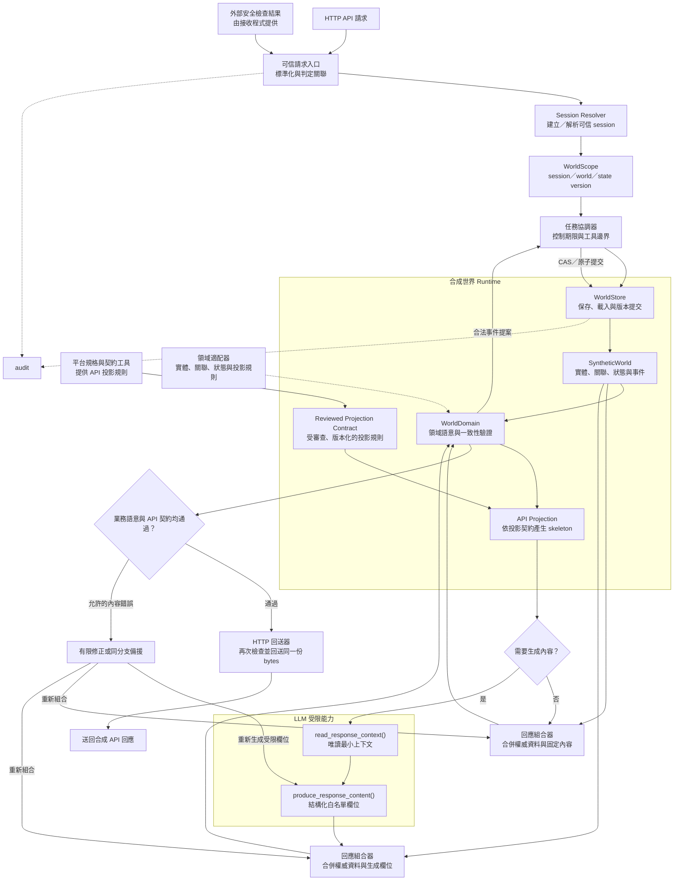

# Mirage_API — 通用型 API 誘餌平台

[](LICENSE)

Mirage_API 用來回應被判定為攻擊的 API 請求。它的目標不是只產生一份通過 schema 的 JSON，而是在符合原本 API 契約與真實可能業務語意的前提下，維持一個可跨請求查詢的合成世界，讓真實回應銜接到合成回應時不易被辨識為誘餌環境。是否為攻擊由外部安全檢查工具判斷，Mirage_API 負責後面的回應流程。

目前可以直接使用的業務類別是電商，設定名稱為 `ecommerce`。電商設定與資料集中在 [domains/ecommerce](domains/ecommerce/README.md)，商品處理程式位於 `src/deception/domains/ecommerce/`。其他業務也能沿用共用流程，但需要補上自己的資料處理程式、情境規則、API 規格、驗證方式及文件，再由部署程式把它們接進共用流程。測試已用工單案例確認這種接法可行，尚未提供可直接部署的工單版本。

各工具的輸入、輸出、用法、失敗處理、驗證與授權見 [工具文件索引](docs/README.md)。

## 系統架構

### Architecture Baseline v1.1

這份架構基準只定義介面契約與安全不變條件，尚未表示可直接部署或已符合 Protocol v1.1。正式整合邊界如下：

| 契約 | 主要責任 | 必須交付 |
| --- | --- | --- |
| `TrustedSessionContext` | 可信 Gateway 與 Mirage Ingress | 簽章、請求綁定、防重放、期限驗證 |
| `WorldScope`／`WorldSnapshot` | Mirage Runtime | 不可變身份、版本快照、資料完整性 |
| `WorldStore` | Mirage Runtime | 明確 LoadResult、CAS、Idempotency、Snapshot Isolation |
| `ProjectionContract` | Mirage Runtime 與領域適配器 | 官方來源、投影規則、版本相容策略 |
| L1／L2 | Mirage_API 與整合測試 | 可執行的正向及負向測試 |
| L3 Continuity | 外部整合層與領域適配器 | 核准資料來源、身份映射、銜接界限 |
| Audit | Mirage Runtime | 事件摘要、版本關聯與最終輸出證據 |

識別與版本欄位不可混用；`jti` 是 TrustedSessionContext v1 的一次性授權識別：

| 識別 | 用途 |
| --- | --- |
| `jti` | 防止相同 JWS 授權被再次消費，由 Mirage 透過共享 Replay Store 原子消費 |
| `request_id` | 跨元件追蹤單次請求 |
| `idempotency_key` | 確保同一業務操作重試不重複提交 |
| `state_version` | 防止並行請求覆寫世界狀態 |

Gateway 負責驗證上游安全判定並簽發 `TrustedSessionContext v1`；Mirage 驗證簽章、受眾、期限、請求綁定並消費 `jti`。JWS v1 只支援 Compact Serialization、`alg=Ed25519`、`typ=mirage-trusted-session+jwt` 與固定 `protocol_version`，`kid` 必填且只能從可信 issuer 的固定金鑰集合選取；禁止 `none`、未知演算法、遠端金鑰 URL、協定自動降級及依 JWS Header 任意載入金鑰。`iss`、`aud`、`iat`、`nbf`、`exp`、`jti`、環境／部署／session 綁定、assessment 摘要及 request fingerprint 必填；有效期與最大 clock skew 由部署政策固定，建議分別不超過 60 秒與 30 秒。金鑰輪替須保留驗證重疊期，撤銷立即拒絕；JWS 不取代 TLS，payload 不放 token、API key、憑證或私有資料。Gateway 與 Mirage 必須以 Golden Vectors 實測簽發、驗證及負向互通；尚未完成前不得宣稱 Runtime 符合 Protocol v1.1。

`jti` Replay 與 `idempotency_key` 使用兩個獨立狀態機：Replay 唯一鍵為 issuer／audience／`jti`，只允許一次成功消費；idempotency key 綁定 `WorldScope`、operation 與操作摘要，相同內容可重用已提交結果，不同內容必須拒絕。合法重試使用新的 JWS／`jti`，但保留同一業務 idempotency key；Gateway 不消費 `jti`，不得與 Mirage 重複消費同一授權。

Replay Store 必須是跨 Mirage Instance 的共享、持久化儲存，具備 issuer／audience／`jti` 的原子唯一性約束。簽章、期限、受眾與請求綁定驗證完成後才可寫入；衝突表示 Replay，儲存不可用或寫入結果未知時一律 fail-closed。保存期限至少涵蓋授權有效期與最大 clock skew，清理不得讓仍可能有效的舊授權重新被接受；單程序記憶體集合或未配置持久化的快取不得作為安全依據。

`TrustedSessionClaims` v1 至少包含 `iss`、`aud`、`iat`、`nbf`、`exp`、`jti`、`environment_id`、`deployment_id`、`session_id`、`session_epoch`、`request_fingerprint`、`assessment_id` 與 `assessment_digest`。其中 `jti` 只表示一次性授權，`request_id` 只作追蹤，兩者都不可取代業務冪等鍵。

Request fingerprint 固定使用 canonicalization v1，涵蓋原始 method、可信路由目標的 path／query、原始 body bytes 及核准 headers。Header 名稱大小寫正規化；具有安全歧義的重複 header 拒絕；排除 hop-by-hop headers；`Host`／authority 以可信 Gateway 路由為準；Authorization 不保存原文，只能使用受控摘要；JSON 不得先重新序列化。Gateway 與 Mirage 必須共享跨語言測試向量，任何無法一致解析的 fingerprint 都拒絕。

### Projection Compatibility Predicate

Profile 不只是一個版本名稱。Runtime 必須對每次請求執行明確的相容性判定。Contract 的每條投影差異都必須保存來源、適用範圍與核准 revision；未具核准證據的差異不得放寬官方契約：

```python
is_compatible(
    snapshot,
    profile,
    contract,
    verified_request,
) -> bool
```

判定必須全部成立：Profile 已核准且未撤銷；world schema 與 domain adapter 版本相容；platform、platform version 與官方 spec SHA 相符；Contract 屬於 Profile 核准集合；method、path、operation、status 與 query context 明確允許；投影及 nullable 規則已通過來源審查。無法判定時回傳不相容，不自動降級或推測其他 Contract；200 與 404 必須各自選用正確 status 的核准投影。官方 OpenAPI 驗證、Reviewed Effective Projection 驗證與差異核准結果必須分開記錄；Effective Projection 通過不得宣稱原始官方 OpenAPI 未經修改即通過。

### World 初始化與 Commit Lookup

Session 首次建立 World 必須使用 `environment_id`、`deployment_id`、`session_id` 與 `session_epoch` 的唯一 SessionBinding，並以資料庫交易執行 atomic create-if-absent。並行請求只能取得同一 World；不能使用每次請求不同的 `jti` 作為初始化鍵。初始化交易結果未知時，必須先查詢，不得盲目重建。

`WorldStore` 必須提供唯讀的：

```python
get_commit_result(
    scope: WorldScope,
    commit_attempt_id: str,
) -> CommitLookupResult
```

`commit_attempt_id` 必須不可猜測。查詢前重新確認可信 SessionBinding，且結果必須屬於同一 `WorldScope`；查詢不得產生 `WorldEvent` 副作用。結果至少區分 `committed`、`rejected`、`pending`、`not_found` 與 `unverifiable`。`not_found` 只表示在授權查詢範圍內沒有紀錄，不得推定操作從未發生；`pending` 不得重新提交；`unverifiable` 不得盲目 retry。

### Response Admission 與 Response Source

`ResponseAdmission` 是一次性的、不可重用的輸出授權。Grant、Claim、Cutover 與 Send Authorization 必須在同一個 Generation 控制序列中形成可驗證的順序；不同 Generation 的 revision 不可直接比較。`UNVERIFIABLE` 是操作結果，不是 Admission Store 的持久化狀態；儲存狀態未知時不得重新 Claim 或假設原 Claim 未發生。

持久化 Admission 狀態至少區分：

```text
GRANTED → CLAIMED → SEND_AUTHORIZED → SEND_STARTED → SEND_COMPLETED
```

以及 `EXPIRED`、`ABANDONED`、`SEND_FAILED`、`SEND_PARTIAL_FAILURE`。`ABANDONED` 不得回到 `GRANTED`；同一 `admission_id` 只能有一次受控 Claim。正常撤銷只阻止新的 Admission；Emergency Revocation 以 `SEND_AUTHORIZED` 作為強一致性控制邊界，之後只提供有限的在途傳輸中止保證。

每份 Synthetic ResponseAdmission 必須且只能引用一種已驗證的來源：

```python
ResponseSource = SnapshotSource | CommitSource | SecurityErrorSource
```

`SnapshotSource` 綁定 `read_admission_id`、`world_generation_id`、`state_version` 與 `state_hash`；`CommitSource` 綁定 `operation_result_digest`、`committed_state_version` 與 `committed_state_hash`；`SecurityErrorSource` 只允許使用核准的固定安全錯誤模板，不代表 SyntheticWorld 或 Medusa 商品資料。`ReadAdmission` 不提供發送權，不能取代 `ResponseAdmission`。

Admission 必須綁定不可變的 `candidate_ref`、候選序列化版本、candidate／body／semantic header hashes、request binding、Generation、授權 revision、authorization deadline 與 transmission deadline。Candidate 在所有合法 Claim、恢復查詢及重新授權期限內必須可讀；不存在、跨 scope 或 hash 不符時拒絕，不得由 LLM 重新生成替代。

### Generation Cutover、Watermark 與安全錯誤

Grant 與 Cutover 必須使用同一 Generation 的單調控制序列。Cutover 前已 Grant 的 Admission，即使在 Cutover 後 Claim，也可依 `admission_scoped_v1` 在期限內使用一次；Cutover 後不得對舊 Generation 新 Grant。舊 Generation 的一般 API GET 拒絕；歷史 Operation Lookup 必須使用獨立 Capability，不得由一般 Session Token、Idempotency Key 或 Commit ID 自動推導。

Read Admission 必須在可信一致性邊界內確認 Generation、Scope、Snapshot integrity 與 Watermark；Watermark 只能單調增加，並行 HTTP 回應不保證依版本順序抵達。`ReadFence` 只能來自已確認的 Commit Result、Session Watermark 或有效簽章版本憑證，Client 任意 Header 不得提高版本下限。

WorldStore、Projection Registry 或其他必要來源不可用時，可使用獨立的 `SecurityErrorSource` 固定安全錯誤路徑；它仍須通過 Status、Headers、Body Template、Request Binding 與最終 Renderer 驗證，不得讀取私人 World 或回退真實 Backend。固定安全錯誤不得偽裝成權威 Medusa 404。

### Hash、Event 與 L3 Gate

Hash／Audit 使用 `hash_encoding_version=1`、SHA-256、長度前綴的無歧義二進位編碼，固定欄位順序、Header 大小寫、順序與重複欄位表示。`body_hash` 取精確 body bytes；`candidate_hash` 取候選 status、ordered headers 與 body bytes；`final_response_hash` 取 Renderer 實際準備交給 ASGI 的 final status、headers 與 body bytes。`response_send_attempted` 或 `asgi_send_completed` 只能表示傳輸層嘗試／完成，不得宣稱 Client 已收到完整回應。

Audit 事件至少分為 `world_initialized`、`business_event`、`request_observed` 與 `response_send_attempted`；初始化事件不得被解讀為商品、庫存或其他業務狀態變更。L3 預設停用，每次使用都必須同時核對 `l3_enabled`、核准 `mapping_id`、mapping version、mapping scope 及 mapping expiry；缺少任一項不得使用推測的真實資料。

整體流程是：收到 API 請求和外部工具的安全檢查結果，建立或解析可信 session，取得該 session 的合成世界，再依領域語意與 API 投影規則產生回應。任務協調器負責安排各工具的工作，讓連續請求使用同一個世界的資料、關聯與狀態。

### 整體流程



1. **接收與識別**：保留原始請求，確認安全檢查結果對應的是這筆請求，再建立或解析可信 session；session 不能只依賴攻擊者提供的任意 ID。
2. **取得合成世界**：以 `WorldScope` 載入同一 session 的 `SyntheticWorld`。`WorldStore` 只負責隔離、保存、版本與 CAS 原子提交，不理解商品或其他領域語意；`WorldDomain` 只判斷實體、關聯、狀態、時間與事件提案是否合法，不能自行提交。
3. **投影與生成**：由受審查且版本化的 `Projection Contract` 決定預設欄位、query／field 規則、nullable、關聯選擇與不可生成欄位。只有需要生成的欄位才呼叫 LLM；LLM 只能透過少量、受限的領域工具讀取本次最小上下文並輸出白名單欄位，不能直接讀寫 `WorldStore` 或 `SyntheticWorld`，也不能決定身份、status、關聯或時間。
4. **驗證與回送**：組合世界的權威資料與固定／受限生成欄位，先通過領域語意驗證，再通過 API 契約驗證。允許的內容錯誤可在限制內修正或使用同分支備援；狀態變更由協調器以 request ID、冪等規則及版本 CAS 控制，最後再次檢查同一份候選才送出。

`WorldScope`、`WorldSnapshot`、`SyntheticWorld`、`WorldStore`、`WorldDomain` 與 session 世界流程目前是 Mirage_API 的架構設計方向；現有資料供應器與合成快照仍是既有相容流程，尚未宣稱已提供完整的持久 session 世界實作。

目前設計先採唯讀世界階段：GET 類查詢不得因回應而改變商品、變體或其他實體狀態。後續若加入 `WorldEvent`，必須由協調器建立交易範圍，由 `WorldStore` 以 `expected_version` 原子驗證、套用及保存；HTTP 回送與狀態提交不是同一個原子交易，因此狀態變更需另有 request ID、冪等執行結果與可重放規則。

核心安全不變條件如下：

- `WorldScope` 只綁定可信 `environment_id`、`deployment_id`、`session_id` 與 `world_id`；`state_version`、`state_hash` 與實體資料屬於 `WorldSnapshot`，由 `WorldStore.load()` 提供，不能由 Client 或 Session Resolver 指定。
- 每次請求獨立驗證 `TrustedSessionContext`、`AttackAssessment`、request fingerprint、期限與防重放識別；request fingerprint 不作為整個 session 的永久身份。
- 無效、過期或無法解析的 session 不得回退到其他 session 的世界；Client 不能直接選擇 `world_id`。
- `WorldStore` 是唯一的世界狀態提交者，版本衝突拒絕，不採 Last-Write-Wins。
- `WorldDomain Registry` 只能載入固定且已審查的領域實作，不從 Client 或 YAML 動態載入任意程式。
- `Projection Contract` 由受信任設定版本化，不能由 Client、query 或 LLM 自行生成或批准；無法確認時 fail-closed。
- LLM 工具沒有 Store 寫入、任意檔案、任意網路或直接 Renderer 權限；上下文有欄位、大小、期限及呼叫次數限制。
- `Session Event Log` 只保存可追溯的 request／commit／response 摘要，不記錄憑證、完整敏感資料或未脫敏模型上下文。
- 已進入 Mirage 後若生成或驗證失敗，不自動轉送回真實服務；是否轉送由外部可信入口明確控制。

### 架構契約與驗收層級

Mirage_API 與外部整合的正式邊界由下列五項契約組成：

| 契約 | 必須保證 | 主要責任 |
| --- | --- | --- |
| `WorldScope`／`WorldSnapshot` | scope 不可由訪客竄改，版本由 Store 控制 | Mirage_API |
| `ProjectionContract` | 投影規則受審查並綁定固定官方規格雜湊 | Mirage_API 與領域適配器 |
| `TrustedSessionContext` | session 來源可信、期限有效、請求不可重放 | 可信 Gateway 與 Mirage_API |
| `WorldStore` CAS | 原子提交，版本衝突不得靜默覆寫 | Mirage_API |
| Real → Synthetic Continuity | API、身份、狀態與資料風格在可保證範圍內一致 | 外部整合驗收 |

`ProjectionCompatibilityProfile` 必須明確包含 `profile_id`、`profile_version`、`profile_sha256`、`platform_id`、`platform_version`、`source_spec_sha256`、`world_schema_version` 與 `domain_adapter_version`。同一 `WorldSnapshot` 可服務多個經核准的 `ProjectionContract`，但只能使用相容 Profile；Profile 撤銷後即使 session 已固定舊版本，也不得繼續使用不安全契約。

`ProjectionContract` 至少綁定 `platform_id`、`operation_id`、method、path、status code、query context、source revision 與 `spec_sha256`，並明確區分欄位缺失、`null`、`[]`、`0` 及空字串。它是獨立受審查的投影規則，不是改寫官方 OpenAPI 的替代品；兩者衝突或無法解釋時 fail-closed。

`WorldSnapshot` 必須是同一版本的不可變邏輯快照。商品、變體、選項與圖片等關聯不得從不同版本讀取；底層若使用多表或分散式儲存，必須使用交易快照、版本化讀取或其他經驗證的 Snapshot Isolation。

`WorldStore` 的最小提交結果需區分 `committed`、`already_committed`、`conflict`、`rejected` 與 `unverifiable`。結果至少包含 status、committed version／state hash、result digest、idempotency key 與明確 failure code；`unverifiable` 必須提供受同一 `WorldScope` 授權的不可猜測 `commit_attempt_id`，由唯讀 `get_commit_result()` 查詢，不得只用 `retryable` 布林值。寫入逾時不得一律 retry，因為未知結果可能已經提交；`GET` 不產生業務狀態變更事件，但 session／world 首次建立可留下獨立的 `world_initialized` 紀錄。

`WorldStore.load()` 也必須區分 `world_found`、`session_not_found`、`expired`、`scope_mismatch`、`corrupted` 與 `storage_unavailable`。只有 Session Resolver 明確授權建立新世界時才能建立 World；Store 不可因故障自動建立替代世界。`scope_mismatch` 的詳細原因只進入受控 Audit，對外使用一致的 fail-closed 結果，不洩漏世界是否存在。

同一 `WorldSnapshot` 必須保存 `world_schema_version`、`domain_adapter_version`、`source_spec_sha256` 與 `compatibility_profile_hash`，不綁死單一 operation 的 Projection Contract。契約變更時，已核准且安全的舊版本沿用；只有存在明確驗證的相容遷移才遷移；不相容、撤銷或無法驗證時 fail-closed，不因契約不相容而默默建立新 World。

Audit 至少關聯 `request_id`、可信上下文摘要、`session_id`／`world_id`、base／committed state version、projection contract hash、candidate hash、domain／contract validation result、final response hash 與 `response_send_attempted`／`asgi_send_completed`。只記錄假名化摘要，不記錄 token、憑證、完整敏感資料或未脫敏模型上下文；傳輸結果不宣稱客戶端確實收到，只表示 ASGI transport 的嘗試或完成狀態。

Hash 範圍必須固定：`body_hash` 是精確序列化 body bytes 的 SHA-256；`candidate_hash` 是 status、ordered headers 與 body bytes 的無歧義 canonical binary encoding 摘要；`final_response_hash` 是 Renderer 實際準備交給 ASGI 的 final status、headers 與 body bytes 摘要。Header 的大小寫、順序、重複欄位與 canonical encoding 必須明確定義，不得以事後重新序列化 JSON 代替實際 bytes。

Real → Synthetic Continuity 分為三層：

- **L1 契約相容**：API schema、欄位投影、HTTP 行為與錯誤格式符合核准規則。
- **L2 世界一致**：同一 session 的身份、關聯、狀態、時間與重複查詢保持穩定，不同 session 隔離。
- **L3 銜接一致**：只對具有可信銜接資料、允許公開欄位與明確身份映射的請求保證真實回應接續；不得為銜接而複製敏感商品、客戶或交易資料。

L1 與 L2 是 Mirage 合成世界的基本驗收層級；L3 是受控整合能力，不能從 L1／L2 推定已具備。

L1／L2 的最低機器驗收包含：

| Test ID | 驗收條件 | 預期 |
| --- | --- | --- |
| L1-01 | 預設 GET 200 投影符合核准規則 | PASS |
| L1-02 | `null`、缺失欄位與空集合語意正確 | PASS |
| L1-03 | 404 的識別值與本次請求一致 | PASS |
| L1-04 | 未核准 query 或錯誤 contract hash | REJECT |
| L1-05 | 同一候選通過 Domain、Contract 與 Renderer | PASS |
| L2-01 | 同一 World／版本重複 GET | 權威資料一致 |
| L2-02 | 不同 session 查詢相同路徑 | 不跨 session 洩漏 |
| L2-03 | Variant／Option／Image 引用 | 全部合法 |
| L2-04 | 時間順序與刪除語意 | PASS |
| L2-05 | 404 查詢 | World 不變 |
| L2-06 | CAS 版本衝突 | 不覆寫新版本 |
| L2-07 | LLM 修改身份、狀態或時間 | REJECT |
| L2-08 | Store 故障或 snapshot 損壞 | Fail-Closed |

### Protocol v1.1 Conformance 狀態

目前 README 描述的是 Protocol v1.1 的規範基線，不是 Runtime 已通過的符合性聲明。以下證據全部完成並通過前，不得宣稱 Mirage Runtime 符合 Protocol v1.1：

- JWS、Admission、Projection、ResponseSource 與錯誤碼的 Golden Vectors。
- Store、Registry、Clock、Network、Crash、Replay、撤銷與未知結果的 Fault Matrix。
- 多 Instance 下 Grant／Claim／Cutover／Send Authorization、Session 隔離、Watermark 與 Fail-Closed 的 Conformance Suite。

缺少任一證據時，實作狀態只能標示為 `Protocol v1.1 design baseline` 或 `not yet conformant`；單元測試、文件審查或單 Instance 測試不得替代上述三項驗證。

Baseline v1.1 另要求下列安全與整合測試：

| Test ID | 測試場景 | 預期 |
| --- | --- | --- |
| SEC-01 | Client 偽造 Session／World ID | REJECT |
| SEC-02 | 已消費 nonce 重放 | REJECT |
| SEC-03 | 新 nonce 搭配相同 idempotency key | 重用已提交結果 |
| SEC-04 | 相同 idempotency key 搭配不同操作摘要 | REJECT |
| SEC-05 | WorldScope mismatch | 對外一致拒絕 |
| SEC-06 | JWS 錯誤 audience／演算法／key | REJECT |
| AUTH-10 | 同一個合法 JWS 同時送到兩個 Mirage Instance | 最多一個首次授權成功 |
| WORLD-01 | 同一 snapshot 的實體與關聯版本一致 | PASS |
| WORLD-02 | 不同 session 狀態隔離 | PASS |
| WORLD-03 | CAS 衝突 | 不覆寫新版本 |
| WORLD-04 | Store 不可用或 snapshot 損壞 | Fail-Closed |
| WORLD-11 | 同一 session 並行首次建立 World | 只有一個有效 WorldBinding |
| PROJ-01 | 多個 operation 使用同一 World | PASS |
| PROJ-02 | Projection Contract hash 不符 | REJECT |
| PROJ-03 | 相容 Profile 下切換合法 Contract | PASS |
| PROJ-04 | 撤銷契約或不相容 Profile | REJECT |
| PROJ-10 | Profile 有效但 Contract 已撤銷 | REJECT |
| HTTP-01 | Candidate 與 Renderer 最終內容一致 | PASS |
| HTTP-02 | 已決定欺敵後 Mirage 失敗 | 不回退真實 backend |
| L3-01 | 沒有核准 mapping | 不使用推測的真實資料 |

上述測試固定 seed、session fixture、domain adapter version、projection contract version 與官方 spec hash，確保結果可重現。

故障注入必須覆蓋 Replay Store 寫入逾時、World 初始化交易結果未知，以及 Commit 已成功但 HTTP 傳輸中斷；這些情況不得以一般 Happy Path 測試替代，且不得因未知結果盲目重放或建立新 World。

### 合成世界的實作階段

為避免一次引入完整交易狀態系統，設計分三階段落地：

1. **唯讀 `SyntheticWorld`**：先完成 session 隔離、穩定身份、Projection Contract、200／404 與領域驗證；查詢不改變世界狀態。
2. **持續 `WorldStore`**：再加入版本快照、CAS 原子提交、TTL、重啟 preserve／new-world 策略及快取隔離。
3. **`WorldEvent` 狀態變更**：最後才加入合法事件、冪等提交、版本衝突、可重放結果與復原測試。

這裡的「可信攻擊判定」，就是外部工具交來的一份安全檢查結果，說明哪筆請求被判斷為攻擊。你要先確認結果確實來自允許的檢查工具，再由自己的程式交給 Mirage_API。這段取回結果的程式叫 `assessment_provider`，文件中簡稱 provider。每個欄位的意思、接法範例及出錯時的處理方式，見 [可信攻擊判定說明](docs/attack-assessment.md)。

圖中呈現元件分工；修正、備援或最終驗證失敗時會停止，不回送未驗證候選。快取、期限、模型不可用及其他錯誤分支詳見 [詳細架構與執行邊界](docs/architecture.md)。

### 領域包如何接入

「領域」就是業務類別，例如電商；「領域包」就是這個類別需要的設定、規格和資料。共用流程負責接收請求、使用模型、組合及檢查回應。你先在 `configs/app.yaml` 選擇類別，例如 `ecommerce`，系統再讀取它的資料夾，使用已接好的處理程式。

| 放置位置 | 負責內容 |
| --- | --- |
| `src/deception/` 的共用模組 | 入口、session／世界流程、識別、協調、生成、組合、驗證與回送 |
| `domains/<domain>/` | 該領域的設定、來源、契約、政策、OWASP 情境及文件 |
| `src/deception/domains/<domain>/` | 該領域的資料模型、WorldDomain、資料供應器與情境處理器 |
| `inputs/security_taxonomies/` | 各領域共用的版本化 OWASP 分類 |

OWASP 分類是設計弱點情境的依據。管理者在啟動時選定已實作的情境，領域處理器套用相應的虛構資料與回應規則；目前不會依每個訪客請求自動判定 OWASP 類別或切換弱點。

目前可以用本地設定檔選擇規則，也可以接上自己的安全檢查結果接收程式。把不同環境的流量導入、確認遠端檢查工具的身分，以及集中管理設定的服務，仍要另外實作。展示模式使用程式產生的模擬檢查結果；虛構資料目前只能讀取，尚無購買扣款或更新庫存的功能；session 世界的交易事件與重啟恢復策略仍待實作。

## 快速使用

在專案根目錄執行：

```powershell
docker compose up --build -d --wait --wait-timeout 180
curl.exe http://127.0.0.1:8000/healthz
curl.exe http://127.0.0.1:8000/demo/info
docker compose exec mirage python tools/verify_domain_api.py --domain ecommerce --base-url http://127.0.0.1:8000
```

預設使用固定文字備援，無需啟動模型。完整 input、呼叫範例、模型模式、持久化與部署方式見 [Docker 說明](docs/docker.md)；商品 API 範例及驗證矩陣見 [電商使用說明](domains/ecommerce/docs/usage.md)。容器預設只發布本機連接埠。

目前工作環境沒有 Docker 引擎；Dockerfile、Compose 與封裝流程已提供，容器實際建置／啟動仍需在具備 Docker 的環境執行。原生 HTTP 驗證與單元測試不能替代容器測試。

## 領域選擇與資料夾

`configs/app.yaml` 明確指定使用領域：

```yaml
schema_version: 1
domain: ecommerce
domains_dir: domains
```

可用 `MIRAGE_APP_CONFIG` 指定另一份設定，或以 `MIRAGE_DOMAIN`、`MIRAGE_DOMAINS_DIR` 覆寫選擇。未知領域、缺少實作、路徑越界及不符 manifest 的資產會停止載入。

```text
configs/
  app.yaml                         # 共用領域選擇
  llm.yaml                         # 共用模型設定
inputs/security_taxonomies/        # 版本化 OWASP 分類
  owasp-api-security-2023.yaml
  owasp-web-2025.yaml
domains/
  ecommerce/
    domain.yaml                    # 電商資產位置
    configs/                       # 展示、部署、生成與組合設定
    inputs/                        # 來源、平台、政策、情境及測試輸入
    security/owasp-scenarios.yaml   # 電商弱點設計及實作狀態
    docs/                          # 電商用法、來源稽核與驗證紀錄
src/deception/
  common/                          # 共用嚴格型別、scope 與資料交換
  domains/ecommerce/               # 商品模型、資料供應器及專用展示
  security/                        # 分類與情境目錄驗證
  api/                             # 共用 FastAPI 入口及領域派送
  discovery/                       # 部署與契約識別
  profile_builder/                 # 固定來源規格與操作摘要
  scenarios/                       # 共用情境引擎與領域介面
  llm/                             # 模型選擇、受控工具及執行預算
  generation/                      # 白名單欄位生成與快取
  core/                            # 協調、組合、修正、驗證與 HTTP 回送
generated/domains/<domain>/        # 隔離的展示產物與驗證報告
tests/
```

共用資料以 `CompositionData(scope, payload)` 傳遞。領域供應器先驗證業務資料，再投影允許映射的 JSON；共用組合器不定義商品欄位。舊 `deception.synthetic` 等匯入路徑保留相容轉出，新實作只有一份。詳見 [領域擴充介面](docs/domains.md) 與 [共用資料交換](docs/common-data.md)。

## 根據 OWASP 設計弱點情境

共用分類採用 [OWASP API Security Top 10 2023](https://api-security.owasp.org/editions/2023/en/0x11-t10/) 與 [OWASP Web Top 10 2025](https://top10.owasp.org/2025/0x00_2025-Introduction/)，保留正式分類 ID 及版次。各領域依適用風險設計自己的誘餌情境與驗證條件；不假設每個產業都有官方專屬 Top 10，跨分類對應是本專案設計。

```powershell
$env:PYTHONPATH = "$PWD/src"
.\.venv\Scripts\python.exe -m deception.domains --list-domains
.\.venv\Scripts\python.exe -m deception.domains --domain ecommerce
```

電商目錄已列出 10 個 API 風險情境，目前兩項可選：

| 情境 ID | 回應行為 | 對應風險 |
| --- | --- | --- |
| `api3-internal-product-properties` | 商品回應包含固定的虛構內部備註 | API3:2023；A01:2025 |
| `api8-debug-header-disclosure` | 回應帶固定虛構舊版系統標頭 | API8:2023；A02:2025 |

在 `domains/ecommerce/configs/demo.yaml` 設定 `weakness_scenario` 選擇；預設 `null`。重啟服務後 `/demo/info` 會顯示啟用情境。剩餘八項標為 `designed`，啟用時會拒絕。這兩項模擬只輸出合成資料，仍經固定欄位保護與契約驗證；沒有執行 SQL、系統命令、任意外連或開放主機權限。詳見 [分類、設計及驗證說明](docs/owasp-design.md)。

## 元件目的與處理流程

| 元件 | 功能及目的 |
| --- | --- |
| HTTP 請求入口 | 保留 method、URL、重複標頭、原始 body 與追蹤 ID，限制請求大小 |
| 平台識別 | 依可信部署綁定選定站點、平台、版本及規格雜湊 |
| Profile 工具 | 從固定來源建置操作摘要，精確取得 method、path、status 與 schema |
| Session／合成世界 Runtime | 以 `WorldScope` 隔離 session，透過 `WorldStore` 取得版本化世界；所有提交使用 CAS，禁止跨 session 混用 |
| WorldDomain 與領域供應器 | 驗證實體、關聯、狀態、時間及事件提案；不直接提交世界，也不由共用核心猜測商品語意 |
| Projection Contract 與 API Projection | 依受審查版本、操作及 query context 決定預設欄位、關聯與可生成範圍 |
| 任務協調器與 LLM 工具 | 只有需要時才呼叫 LLM，提供最小唯讀上下文與結構化欄位輸出；LLM 不直接操作世界 |
| 內容生成器 | 只生成政策允許的欄位，保護事實映射與固定值，按上下文快取 |
| 回應組合與契約 gate | 組合完整候選，先驗證領域語意，再以選定 OpenAPI 契約驗證結構及 HTTP metadata |
| 修正與備援 | 有限重新生成或使用精確同分支備援，再次驗證 |
| HTTP 回送器 | 重驗最終傳輸候選，回送原始 body bytes、狀態與標頭 |

`deception.api.demo:create_app` 是依領域派送的隔離展示入口，使用合成契約及模擬惡意判定。正式整合由 `deception.api.pipeline.create_app` 注入可信判定 provider 與部署設定。單獨的 `deception.api.app:app` 及僅平台識別入口維持診斷用途，不會自動生成完整回應。

預設本機模型為 `hf.co/fdtn-ai/Foundation-Sec-8B-Reasoning-Q4_K_M-GGUF:Q4_K_M`，可列出及選擇已安裝的精確模型，不會自動下載。模型模式、遠端主機透過受控隧道連接本機 Ollama、權重與 tokenizer 條款見 [模型工具](docs/llm.md) 及 [協調與生成](docs/orchestration.md)。

## 驗證與目前邊界

需要 Python 3.11+，在專案根目錄執行：

```powershell
python -m venv .venv
.\.venv\Scripts\python.exe -m pip install -e ".[test]"
.\.venv\Scripts\python.exe -m pytest -q
.\.venv\Scripts\python.exe tools/check_documentation.py
$env:PYTHONPATH = "$PWD/src"
.\.venv\Scripts\python.exe -m uvicorn deception.api.demo:create_app --factory --host 127.0.0.1 --port 8000 --no-proxy-headers
```

另一個終端機執行：

```powershell
.\.venv\Scripts\python.exe tools/verify_domain_api.py --domain ecommerce --base-url http://127.0.0.1:8000
```

HTTP 驗證器執行 16 個一般及攻擊特徵請求，檢查 `200 → 404 → 200`、不同商品隔離、提示與標頭注入、未支援寫入及快照不變；預設報告為 `generated/domains/ecommerce/verification/http-api.json`。單元測試另覆蓋兩個弱點模擬、錯誤設定拒絕，以及非電商工單完整協調、生成、契約驗證與回送。歷史本機 Foundation 模型證據與限制見 [電商驗證紀錄](domains/ecommerce/docs/verification.md)。

目前合成資料為唯讀快照，購買、扣款、庫存更新與完整 session 世界交易隔離尚未提供。WorldStore／WorldDomain 的 session 世界、CAS 提交、Projection Contract 與按需 LLM 流程仍待落實；遠端可信判定來源認證、各部署的代理接入、集中設定服務及真實部署對照也仍待實作。平台版本、來源核准狀態與稽核紀錄全部留在 [電商領域文件](domains/ecommerce/README.md)。

其他入口、驗證 API input 及故障處理見 [HTTP 入口](docs/ingress.md)、[平台識別](docs/identifier.md) 及 [契約驗證](docs/gate.md)。所有具名函式、測試與輔助程式都須有功能 docstring，並由文件檢查確認。

## 開源軟體、模型與資料授權

本專案自有原始碼與原創文件採用 **Apache License 2.0**，授權全文見 [LICENSE](LICENSE)，歸屬及第三方材料見 [NOTICE](NOTICE) 與 [授權範圍說明](docs/licensing.md)。Medusa 衍生規格保留 MIT，OWASP 分類及其翻譯保留 CC-BY-SA-4.0；套件、來源資料與另行取得的模型權重各依原條款，不因本專案採 Apache-2.0 而改變。

以下按本 repo 的 `pyproject.toml` 和上游授權資料區分。**採用**是現有直接依賴，**規劃／可選**未集成，**未採用**沒有引入。連結指向上游授權或官方資料；發行前仍須按實際鎖定版本及間接依賴逐項核對。

| 類別 | 專案 | 上游授權／來源 | 用途與界線 |
| --- | --- | --- | --- |
| 採用 | [FastAPI](https://github.com/fastapi/fastapi/blob/master/LICENSE) | MIT | 驗證 API、HTTP 請求入口原始入口及可選完整 HTTP app |
| 採用 | [Uvicorn](https://github.com/Kludex/uvicorn/blob/main/LICENSE.md) | BSD-3-Clause | FastAPI 的 ASGI 執行服務 |
| 測試採用 | [pytest](https://github.com/pytest-dev/pytest/blob/8.4.2/LICENSE)／[HTTPX](https://github.com/encode/httpx/blob/0.28.1/LICENSE.md) | MIT／BSD-3-Clause | 單元、整合測試與測試 HTTP client |
| 採用分類資料 | [OWASP API Security](https://github.com/OWASP/API-Security/blob/master/LICENSE)／[OWASP Top 10](https://github.com/OWASP/Top10/blob/master/LICENSE) | CC-BY-SA-4.0 | 分類 ID／名稱及本專案中文翻譯；出處、修改與共享條款見 [分類文件](docs/owasp-design.md)，未引入漏洞執行程式 |
| 採用既有間接依賴 | [Starlette](https://github.com/Kludex/starlette/blob/main/LICENSE.md) | BSD-3-Clause | FastAPI 的 ASGI 基礎；HTTP 回送器原始 bytes／headers 回送，未新增套件 |
| 採用 | [Pydantic](https://github.com/pydantic/pydantic/blob/main/LICENSE) | MIT | 嚴格輸入／輸出模型與情境選擇工具白名單政策 |
| 採用 | [openapi-core](https://github.com/python-openapi/openapi-core/blob/master/LICENSE) | BSD-3-Clause | 正式 OpenAPI 驗證；保留版權、授權與免責聲明，不用作者名稱背書 |
| 採用 | [Werkzeug](https://github.com/pallets/werkzeug/blob/3.1.1/LICENSE.txt) | BSD-3-Clause | 回應組合與契約驗證的 HTTP headers adapter |
| 採用 | [PyYAML](https://github.com/yaml/pyyaml/blob/6.0.3/LICENSE) | MIT | 來源、Profile、情境選擇工具政策與組合指令讀取 |
| 採用 | [jsonschema](https://github.com/python-jsonschema/jsonschema/blob/main/COPYING) | MIT | PoC 自訂契約及既有 OpenAPI 驗證依賴鏈；不代替網站部署 gate |
| 使用的外部程式 | [Ollama](https://github.com/ollama/ollama/blob/main/LICENSE) | MIT，限此**程式碼** | 任務協調與內容生成連接的本機推論服務；模型權重有各自條款，不能從 Ollama 授權推定模型可商用或再散布 |
| 採用 | [Pydantic AI](https://github.com/pydantic/pydantic-ai/blob/v2.66.0/LICENSE) | MIT | `pydantic-ai-slim[openai]==2.66.0`，任務協調器的工具規劃與內容生成器的結構輸出；相容 client 連接本機 Ollama，主要間接依賴授權見 [任務協調與內容生成說明](docs/orchestration.md#套件模型與資料授權) |
| 僅參考 | [Galah](https://github.com/0x4D31/galah/blob/main/LICENSE) | Apache-2.0 | 參考公開提示、生成與快取設計；未引入 Go runtime 或複製程式碼 |
| 採用 | [Faker](https://faker.readthedocs.io/en/stable/#license) | MIT | 合成資料工具的商品文字生成；鎖定 40.44.0，使用獨立 instance seed |
| 可選 | [Prism](https://github.com/stoplightio/prism/blob/main/LICENSE) | Apache-2.0 | 外部 mock 比對，不是現有回應組合與契約驗證 |
| 可選 | [Schemathesis](https://github.com/schemathesis/schemathesis/blob/master/LICENSE) | MIT | 契約測試；通過仍不等於官方行為一致 |
| 未採用 | [WireMock](https://github.com/wiremock/wiremock/blob/master/LICENSE.txt) | Apache-2.0 | 可作替代 mock server；目前無依賴 |
| 未採用 | [Tenacity](https://github.com/jd/tenacity/blob/main/LICENSE) | Apache-2.0 | 修正與備援工具評估過的通用有限重試元件；沿用主機共用預算與既有模型介面，未加入依賴 |
| 參考資料 | [WooCommerce REST API 文件](https://developer.woocommerce.com/docs/apis/rest-api/v3/products/)／[外掛授權標示](https://github.com/woocommerce/woocommerce/blob/trunk/plugins/woocommerce/readme.txt) | 文件、程式碼與範例權利須分開核對；外掛標示 GPLv3+ | 僅參考 API 行為，未複製其程式碼。閱讀 GPL 專案文件不會使獨立實作自動受 GPL 約束；若複製程式碼或大量文件，須另評估 |
| 採用規格子集 | [Medusa Store API 文件](https://docs.medusajs.com/api/store)／[固定版本授權](licenses/Medusa-MIT.txt) | 非企業版來源採 MIT；上游企業版路徑另有條款 | 兩份規格子集保留上游版權與 MIT 全文，修改及來源見 NOTICE；正式部署尚未對照 |

`pyproject.toml` 還列有 `uvicorn`、`PyYAML`、`werkzeug`、`Faker==40.44.0`，測試 extra 有 `pytest`、`httpx`；它們及**間接依賴**（例如 Faker 安裝帶入的 `tzdata`）也須按實際解析出的版本納入第三方清單。合成資料工具只使用 Faker 的公開 API，不複製其原始碼或資料。Polyfactory 與 hypothesis-jsonschema 僅是評估過、未安裝的候選。上表不是完整 SBOM；本專案 Apache-2.0 授權與各第三方材料的授權範圍分開記錄。

內部執行與提供軟體、容器、模型或規格給他人，所涉義務可能不同。分發時依實際包含元件保存 MIT／BSD／Apache 等授權與版權聲明；Apache-2.0 元件若帶 `NOTICE`，按條款保留適用內容並標示修改。README 簡表不能替代授權檔與 NOTICE。另核對模型權重的使用／商用／再散布條款，以及下載或打包的 API 規格、範例、文件的個別權利。不要把「依賴某個 LGPL／GPL 程式」直接等同整個獨立專案必須改用該授權；若未來引入其程式碼或連結／分發該元件，按**具體版本、整合方式與分發形式**評估並履行義務。
