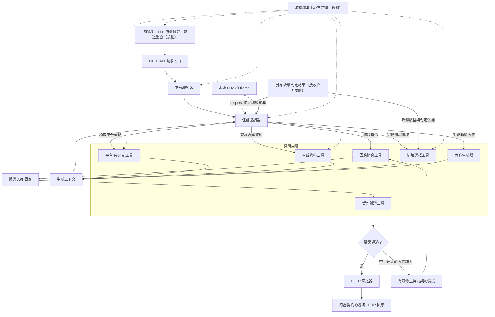

# Mirage_API — Universal LLM-driven API Deception Platform

**跨環境、跨框架、可擴充的 API 誘餌回應生成平台。**

各工具的用途、輸入輸出、用法、驗證及授權集中在 [工具文件索引](docs/README.md)。新增或修改函式須同步維護功能 docstring，規範與檢查方式見 [文件維護說明](docs/documentation.md)。

Mirage_API 的製作目標是整合不同部署環境的 HTTP 流量入口，接收外部系統提供的攻擊判定結果，依目標 Web 服務的 API 契約、虛構資料及互動狀態，使用本地 LLM 動態生成誘餌回應，並在驗證後輸出符合原服務契約的 HTTP Response。多個部署環境及其設定由集中管理能力統一維護。

電商是初期驗證案例，範圍包含 Medusa（測試目標 `v2.22.4`）與 WooCommerce；整體平台的設計目標涵蓋其他 Web 服務、應用框架與部署方式。情境選擇工具以 `domain: ecommerce` 選擇電商領域；此處的「Platform」表示該領域下的目標服務及其契約、版本與部署設定。領域可透過型別化政策及處理器擴充，目前內建可用領域只有電商。

## 核心能力與目前進度

先試用完整 HTTP 流程可閱讀 [Docker 封裝、input 與呼叫方式](docs/docker.md)，各元件的功能及目的集中在 [工具文件索引](docs/README.md)。隔離展示會使用合成契約與模擬惡意判定，不會核准正式 Medusa／WooCommerce 來源。

```powershell
docker compose up --build -d --wait --wait-timeout 180
curl.exe http://127.0.0.1:8000/healthz
curl.exe http://127.0.0.1:8000/demo/info
docker compose exec mirage python tools/verify_ecommerce_api.py --base-url http://127.0.0.1:8000 --output /app/generated/verification/ecommerce-api.json
```

`configs/demo.yaml` 是展示 input：明確選 `domain: ecommerce`、設定種子、商品數量及固定備援文字；預設不啟動模型。`/demo/info` 提供可查詢的商品 ID。查詢方式如下：

```powershell
$demo = Invoke-RestMethod http://127.0.0.1:8000/demo/info
$productId = $demo.product_ids[0]
curl.exe -i "http://127.0.0.1:8000/api/products/$productId" -H "X-Request-ID: demo-product-001"
```

[HTTP 驗證工具](docs/verification.md) 送出 16 個攻擊特徵與一般請求，檢查 `200 → 404 → 200`、不同商品隔離、標頭／提示注入、未支援寫入與資料快照不變，並輸出 JSON 報告。模型生成、快取與固定備援會分開記錄。購買扣款與庫存寫入尚未提供，測試要求其明確拒絕，不能當成交易一致性已完成。

以下七項是平台的製作目標；進度以本 repository 的實作為準。

1. **多環境 HTTP 流量攔截整合**：透過部署環境的代理、閘道或應用程式整合介面，將指定流量導入統一入口，保留原服務識別與請求資訊。
2. **接收外部攻擊判定結果**：取得外部偵測器提供的判定、攻擊類型與證據摘要，與原請求關聯，作為誘餌情境及生成策略的輸入。攻擊偵測由外部系統負責。
3. **根據不同 Web 服務的 API 契約生成誘餌回應**：依服務、操作、版本、狀態碼、媒體類型及 schema 選擇生成約束，透過 Profile 與服務對映擴充支援範圍。
4. **維護跨 API 的虛構資料及互動狀態**：讓同一互動中的列表、明細與後續操作引用相同實體，並在允許的操作後更新虛構狀態；不同環境與互動彼此隔離。
5. **使用本地 LLM 動態生成回應**：由協調器調用本地模型與受限工具，根據契約、外部判定、情境及虛構狀態生成內容。
6. **輸出符合原服務契約的 HTTP Response**：組合 status、headers 與 body，通過對應契約驗證後渲染；失敗時執行有界修正或再次驗證備援。
7. **集中管理多個部署環境及其設定**：統一維護環境、部署、服務、契約、Profile、生成策略與模型設定的關聯和版本，供各環境取得適用設定。

| 核心能力 | 已有基礎 | 尚待完成 |
| --- | --- | --- |
| 多環境流量攔截整合 | HTTP 請求入口：FastAPI HTTP 入口；平台識別器：明確部署綁定；可選 HTTP 請求入口→平台識別器診斷及 HTTP 請求入口→任務協調與修正備援→HTTP 回送器完整 app | 各環境流量攔截／轉送接入、可信代理與統一轉接介面 |
| 外部攻擊判定接收 | HTTP 請求入口保留 request ID；情境選擇工具核對時效／請求關聯；完整 app 明確注入可信判定 provider | 遠端判定接收器、來源認證及事件整合 |
| 依多服務契約生成 | 平台識別與規格工具：固定身份與契約；任務協調、內容生成與生成上下文：受控本機生成；回應組合、契約驗證、修正備援及 HTTP 回送工具：組合、修正／備援、驗證與 HTTP 回送 | 更多服務、真實部署及生成欄位對映 |
| 跨 API 虛構資料與互動狀態 | 合成資料工具：可重現、可查詢的商品／變體資料與關聯 | 跨請求狀態更新、寫入操作、互動／session 隔離與並行一致性 |
| 本地 LLM 動態生成 | 任務協調器自家控制流程、Pydantic AI 受控工具規劃、內容生成器本機 Ollama 結構生成與衍生內容快取；可選完整 HTTP 接入 | 更多真實樣本、模型品質與效能評估 |
| 契約一致的 HTTP 輸出 | 回應組合與契約驗證：組合與驗證；修正與備援工具：有限修正／同分支欄位備援；HTTP 回送器：最終傳輸候選重驗與原樣回送 | 真實平台與部署對照、更多 HTTP 媒體及傳輸情境 |
| 多環境集中管理 | 本地來源／生成設定、平台識別器部署 binding 與可信 runtime context | 集中設定儲存、管理介面、版本發布與代理整合 |

目前 HTTP 請求入口、平台識別器、任務協調器、平台規格工具、合成資料工具、情境選擇工具、內容生成器、回應組合器、契約驗證器、修正與備援工具、HTTP 回送器已提供工具介面；任務協調器與生成上下文串接固定身份、情境、資料、內容生成與回應組合與契約驗證，修正與備援工具提供有限重新生成及精確同分支的確定性欄位備援，HTTP 回送器重新驗證最終傳輸候選後回送。管理者可透過 `deception.api.pipeline.create_app` 注入可信判定 provider、runtime 及資料設定，啟用 HTTP 請求入口→任務協調與修正備援→HTTP 回送器。僅平台識別診斷 handler 成功仍回 `501 orchestrator_not_implemented`；原始 HTTP 請求入口預設仍回 `501 pipeline_not_implemented`。情境選擇工具以 `domain: ecommerce` 選電商，各工具使用同一領域與快照。外部判定來源認證接收器、圖形介面、集中管理、OCI／真實 Medusa 部署對照及交易狀態更新尚未完成。本文所有「規劃」格式不能當作現有 API 使用。

## 系統架構與整合邊界

下圖保留從 HTTP 請求入口到誘餌回應的生成與驗證主流程，補上環境流量整合、外部攻擊判定及集中設定管理。任務協調、內容生成、生成上下文、修正備援及 HTTP 回送工具已提供內部流程與可選 HTTP 接入；環境流量整合、來源認證接收器及集中設定仍為規劃。虛線表示設定供給。



跨環境的整合層負責流量導入與回送，服務 Profile 負責契約差異，任務協調、生成、組合與契約驗證的核心流程使用一致的內部資料介面。擴充某個應用框架或部署環境時，應增加對應的轉接與設定，維持核心生成流程共用。目前 FastAPI 是 Mirage_API 自身的入口框架，目標服務可採用其他框架；具體框架的相容性仍需逐一驗證。

外部判定須與 `request_id`、環境及服務身份關聯。判定本身用來選擇情境和策略，不能取代 API 契約或放寬驗證規則。情境選擇工具會拒絕缺少、未知、過期或與請求不符的判定；來源白名單並不是來源認證。接收層的認證、事件去重及流量導向仍待實作，不能把任意用戶端 header 直接當作可信攻擊判定。

集中管理屬於設定管理能力：預期將環境、部署、服務版本、契約雜湊、Profile、情境、生成策略與模型設定綁定成可追溯的設定版本。請求處理使用確定的一份設定，避免執行中混用不同版本。目前只有本地檔案與工具，尚無集中管理服務。

「合成」表示平台維護的虛構資料；初期例子使用商品與變體。契約通過只證明符合**已載入、適用於該服務和版本的規格**，不能單憑此聲稱與官方服務所有行為一致。請只在獲授權的測試環境使用，不要把真實憑證或顧客個資放入提示或樣本。

## 模組、輸入輸出與調用關係

| 節點 | 輸入 → 職責 → 輸出 | 狀態 |
| --- | --- | --- |
| HTTP API 請求入口 | method、URL、headers、body → 保留原始 URL、query、追蹤 ID 的標準化請求；由伺服器注入部署上下文 | **已實作**：原始 app 預設回 501，僅平台識別 handler 維持診斷用途；`deception.api.pipeline` 提供可選完整任務協調、修正備援及 HTTP 回送接入 |
| 平台識別器 | 環境／部署／服務綁定、origin、API 前綴、method、path、版本 → 唯一平台與 operation；不明時拒絕猜測 | **已實作**：`src/deception/discovery/`；與契約驗證器共用匹配器，可接 HTTP 請求入口／平台規格工具；代理整合與集中設定管理尚未實作 |
| 任務協調器與本機模型工具 | 可信請求、外部判定、生成政策 → 強制平台識別、規格、合成資料及情境工具檢查、受限工具規劃、內容生成、修正／備援、回應組合與契約驗證 | **已實作**：`src/deception/core/orchestrator.py` 與 `src/deception/llm/`；共用預算與期限，內部結果可交 HTTP 回送器回送，見 [任務協調與內容生成說明](docs/orchestration.md) |
| 平台 Profile 工具 | 固定來源與 OpenAPI → 可追溯的操作、參數、狀態碼、媒體類型、schema 上下文 | **已實作**：`src/deception/profile_builder/`；提供 CLI 建立及 Python 查詢，任務協調器依精確身份調用；不推測平台慣例 |
| 合成資料工具 | 種子、隔離身份、資料規則 → 跨操作可引用的虛構實體；未來維護互動造成的狀態變更 | **已實作**：`src/deception/synthetic/` 的商品／變體生成、保存、驗證與只讀查詢；顧客、訂單及互動狀態更新尚未實作 |
| 情境選擇工具 | 領域政策、可信整合層的判定、白名單與平台識別與規格工具 → 固定 family；領域處理器再依資料選分支與回應組合器計畫 | **已實作**：`src/deception/scenarios/`；可選 `ecommerce`，提供 GET 商品 200／404、可追溯決策及交接完整性；領域可註冊擴充，尚無其他真實領域資料，不偵測攻擊或更新交易狀態，詳見 [情境選擇工具功能、驗證與授權](docs/scenarios.md) |
| 內容生成器 | 固定欄位 schema、唯讀事實與情境 → 允許欄位的動態 JSON 片段 | **已實作**：`src/deception/generation/`；保護合成資料工具映射與政策欄位，內容經回應組合與契約驗證後發布至獨立快取 |
| 生成上下文 | 工具結果 → 固定領域、請求指紋、部署／契約／資料摘要、情境及政策／模型版本 | **已實作**：`deception.generation.GenerationContext`，由任務協調器建立與綁定，不包含原始憑證 |
| 回應組合工具 | 明確指令、平台規格工具契約、可選合成資料工具映射 → status、headers、已序列化 body | **已實作**：`src/deception/core/`；已接任務協調器與生成上下文內部流程，UTF-8 JSON、嚴格 metadata 與契約 preflight，產物仍需契約驗證器驗證 |
| 契約驗證工具 | 候選 status、headers、body 及原請求 URL／method → `pass`、`reject` 或 `unverifiable` 與錯誤 | **已實作** |
| 修正或備援 | 允許的內容錯誤 → 有限重新生成或精確匹配的固定欄位備援 → 回應組合與契約驗證重驗 | **已實作**：`src/deception/core/recovery.py`；備援預設停用，保護情境選擇工具結果與合成資料工具映射，不發布模型內容快取，見 [修正與備援工具說明](docs/recovery.md) |
| HTTP 回送器 | 同請求的已驗證候選 → 完成傳輸欄位、再執行契約驗證 → 原樣 status、headers、body bytes | **已實作**：`src/deception/core/renderer.py` 與 `src/deception/api/pipeline.py`；發送前阻擋驗證後變更，見 [HTTP 回送器說明](docs/renderer.md) |

HTTP 請求入口 → 平台識別器 → 任務協調器；任務協調器關聯可信 provider 的判定，分別調用平台規格工具/合成資料工具/情境選擇工具/內容生成器，匯成生成上下文，再指示回應組合器建立候選回應；契約驗證器驗證候選回應。修正與備援工具對允許的內容錯誤使用固定上限與同一總預算重新生成，耗盡後只使用管理者明列的同契約／同分支欄位備援並重驗回應組合與契約驗證。`unverifiable`、身份或 HTTP metadata 錯誤不能由模型修正或備援掩蓋。HTTP 回送器完成本次追蹤 ID 與 UTF-8 長度後再執行契約驗證，回送完全相同的 status、headers、body bytes。完整 app 對未適用回 409、無法完成回固定 503 診斷；不自動轉送正常流量，也不把診斷當成平台契約回應。

規劃中的跨 API 互動應共用明確的虛構實體與狀態版本。例如建立一筆虛構資源後，列表與明細 API 應能讀到相同 ID 與欄位，後續更新及刪除也應反映在同一互動中。狀態寫入需配合契約驗證、並行控制與重試去重，避免修正一次回應就重複建立資源；目前尚無這類狀態寫入流程。

## 檔案與輸入資料

核心流程使用下列輸入；外部判定與部署上下文由整合層補入。檔案存在與模組實際載入的狀態需分別確認。

| 輸入 | 內容與用途 | 目前對應 |
| --- | --- | --- |
| HTTP Request | 原始 method、URL、query、headers、body 與追蹤 ID | HTTP 請求入口的 `NormalizedRequest` 已實作 |
| API Specification | 固定版本的操作、參數、狀態碼、headers 與回應 schema | 平台規格工具的 `inputs/sources/`；契約驗證器另讀 `inputs/platforms/` 的部署契約 |
| Platform Profile | 服務版本、契約來源、operation 摘要及生成上下文 | 平台規格工具已建立 `generated/profiles/`；完整服務慣例與回應對映仍待擴充 |
| Scenario Configuration | 領域、情境白名單、適用操作及外部判定的情境選擇規則 | 情境選擇工具讀取 `inputs/policies/deception.yaml` 格式，必填 `domain: ecommerce`；現有 `inputs/scenarios/` 草稿不自動載入 |
| Synthetic State | 跨 API 共用的虛構實體、關聯與互動狀態 | 合成資料工具已有商品／變體快照；狀態更新尚未實作 |
| Generation Policy | 模型、工具權限、可生成欄位、保護位置及共用預算 | 任務協調與內容生成讀取 `inputs/policies/generation.yaml` 格式與 `configs/llm.yaml`；`configs/generation.yaml` 只管理合成資料規則 |
| Recovery Policy | 精確契約／結果、情境選擇工具/內容生成器政策摘要與備援欄位值 | 修正與備援工具讀取 `inputs/policies/recovery.yaml` 格式，由管理者明確注入；範本預設停用 |
| 外部攻擊判定 | 與請求關聯的攻擊標籤、來源與判定依據 | 情境選擇工具已有嚴格模型與關聯檢查；接收及來源認證介面待實作 |
| 部署與環境設定 | 環境／部署／服務綁定及本次使用的設定版本 | 本地設定可供個別工具使用；集中管理待實作 |

```text
Mirage_API/
├─ README.md
├─ pyproject.toml                    # 現有驗證器依賴及測試設定
├─ .env.example                      # MIRAGE_PLATFORMS_DIR 設定提示
├─ src/deception/api/               # HTTP 請求入口：原生請求入口；pipeline.py 提供可選任務協調、修正備援及 HTTP 回送接入
├─ src/deception/discovery/         # 平台識別器：明確部署綁定、唯一契約與操作識別
├─ src/deception/profile_builder/   # 平台規格工具：來源檢查、Profile 建立與操作查詢
├─ src/deception/synthetic/         # 合成資料工具：合成商品、變體、資料關聯與有效性驗證
├─ src/deception/scenarios/         # 情境選擇工具：共用引擎、領域註冊、情境與回應組合器計畫
│  └─ domains/ecommerce.py          # 電商政策、商品規則及 prepare／resolve 處理器
├─ src/deception/core/              # 任務協調器：協調；回應組合器：組合；修正與備援工具：修正／備援；HTTP 回送器：最終驗證與回送
│  ├─ orchestrator.py              # 固定身份、資料、總預算與發布期限
│  ├─ recovery.py                  # 修正與備援工具：有限修正與同分支確定性欄位備援
│  └─ renderer.py                  # HTTP 回送器：最終契約驗證器驗證與封存 HTTP Response
├─ src/deception/generation/        # 內容生成器/生成上下文：生成白名單、固定上下文與已驗證內容快取
├─ src/deception/llm/               # Pydantic AI、本機 Ollama 設定及共用預算
├─ configs/llm.yaml                 # 任務協調與內容生成：本機模型名稱、完整 digest 與輸出限制
├─ configs/generation.yaml          # 合成資料工具：隔離身份、種子、數量與生成規則
├─ configs/composition.yaml         # 回應組合器：明確狀態、headers、body 與映射指令
├─ configs/bindings.yaml            # 平台識別器：環境／部署／站點與固定契約綁定
├─ inputs/sources/                  # 平台規格工具：source.yaml 與固定 OpenAPI 輸入
├─ inputs/policies/deception.yaml    # 情境選擇工具：停用的部署／情境政策範本
├─ inputs/policies/generation.yaml   # 任務協調與內容生成：停用的生成白名單及共用預算範本
├─ inputs/policies/recovery.yaml     # 修正與備援工具：停用的精確同分支欄位備援範本
├─ generated/                       # profiles、schemas、synthetic_data、scenarios、generation、responses
├─ mirage_validator/                 # 已實作的驗證 API、網站契約 gate、PoC 驗證
│  └─ contracts/*.json               # 與正式契約隔離的 PoC 示意契約
├─ inputs/platforms/
│  ├─ woocommerce/
│  │  └─ manifest.yaml.example       # 人工待填範本；不載入
│  └─ medusa/
│     ├─ openapi.yaml                # 固定官方來源修正的 Store／Auth 子集；部署待核實
│     ├─ manifest.yaml.example       # 人工待審範本；不載入
│     ├─ api-scope.json              # 使用者提供的操作範圍；程式不讀
│     ├─ input-audit.json            # 已產生的檢查紀錄；程式不讀
│     └─ README.md                   # 此規格的來源與缺口
├─ fixtures/                         # 現有兩平台 PoC 驗證範例
├─ tests/                            # 現有驗證器測試
└─ docs/                             # 工具索引、各模組功能／使用／驗證／授權說明
```

**人工必要輸入（啟用網站契約前）**：在 `inputs/platforms/<站點與版本套件>/` 放入經核對的固定版本 `openapi.yaml`（或 manifest 指定檔名）及 `manifest.yaml`；填入精確平台／部署版本、真正的來源 URL 與不可變 revision、規格 SHA-256、實際站點 `base_urls`、已審查的 `query_contexts`。`approved: true` 只能由維護者在來源、部署和適用範圍審查完成後設定；雜湊正確不等於官方或部署相符。只接受打包好的內部 `$ref`，不能讓請求指定本地檔案或自動抓遠端引用。

**平台規格工具的人工輸入與系統產物**：提供 `inputs/sources/<platform>/source.yaml` 與同目錄固定規格後，平台規格工具產生 `generated/profiles/<platform>.yaml` 和 `generated/schemas/<platform>/<sha256>.yaml`。未審來源可離線預覽，但查詢預設拒絕使用；平台規格工具不改寫驗證器的 manifest。下方早期 `inputs/profiles/` 範例仍是生成規則的規劃格式，不是平台規格工具的 parser。情境與種子草稿也尚未接上執行流程。Profile 不能放寬 OpenAPI 回應契約。

**合成資料工具的輸入與產物**：`configs/generation.yaml` 定義種子、站點／版本／規格／情境／run 隔離與數量、價格、庫存規則。合成資料工具產生 `generated/synthetic_data/<platform>/<namespace>.json`，保留完整設定及生成器／Faker 版本，並驗證資料關聯與可重現性。任務協調器與生成上下文已保存資料 namespace 與快照摘要，`samples/` 的真實服務對照尚未實作。現有 `input-audit.json` 是檢查產物，`api-scope.json` 是範圍紀錄，兩者均不參與驗證執行。

**情境選擇工具的輸入與產物**：`inputs/policies/deception.yaml` 提供明寫 `domain: ecommerce` 的停用政策範本。`ScenarioEngine(policy, domain="ecommerce")` 可核對選擇的領域；省略呼叫參數時依政策領域，未知或不符領域會拒絕。`prepare` 核對可信整合層的判定與平台識別與規格工具，選出固定 family scope；電商處理器再依同一合成資料工具快照選 200／404，回傳回應組合器計畫與領域／政策／模板／資料摘要。`python -m deception.scenarios --list-domains` 列出已註冊領域，`python -m deception.scenarios --demo --domain ecommerce` 執行電商合成契約的離線整合展示並保存 `generated/scenarios/` 報告。`domain` 是業務領域，`platform_id` 是 Medusa／WooCommerce 等服務，`scenario_id` 是 `product-lookup` 等情境，`outcome_id` 則是 `found`／`missing` 等結果；用法、擴充介面、有效性測試及套件授權見 [情境選擇工具說明](docs/scenarios.md)。可選完整 HTTP 接入已使用同一情境選擇工具流程；其他領域、購買扣款、庫存更新與真實部署對照仍待擴充。

**任務協調與內容生成的輸入與產物**：`configs/llm.yaml` 固定本機模型身份，`inputs/policies/generation.yaml` 提供停用的可生成欄位／保護位置及總預算範本。任務協調器與生成上下文將平台識別、規格及情境工具與同一合成資料工具快照綁定，再透過 Pydantic AI 執行工具規劃及內容生成器的局部 JSON 生成，回應組合與契約驗證完成驗證後才發布衍生內容快取。真本機展示明確使用 `python -m deception.generation --demo --domain ecommerce --llm-config configs/llm.yaml`，報告及 SQLite 保存至 `generated/generation/`；FunctionModel 測試與實際 Ollama 生成的證據分開。詳見 [任務協調與內容生成功能、API、CLI 與授權](docs/orchestration.md)。

**修正與備援工具/HTTP 回送器的輸入與輸出**：`inputs/policies/recovery.yaml` 的備援規則精確綁定內容生成器規則、情境選擇工具/內容生成器政策摘要、契約及結果，只提供內容生成器已允許的欄位值。任務協調器將同請求的已驗證候選與有效發布期限交給 HTTP 回送器；HTTP 回送器完成傳輸標頭後重新執行契約驗證，再回送原 bytes。完整 HTTP app 需要管理者明確注入可信判定 provider，不自動認證訪客宣稱的判定。詳見 [修正與備援工具政策與用法](docs/recovery.md) 及 [HTTP 回送器接入與部署界線](docs/renderer.md)。

### 現有 manifest 格式示例（未啟用）

```yaml
platform_id: woocommerce
platform_version: REPLACE_WITH_DEPLOYED_VERSION
source_url: https://REPLACE_WITH_VERSIONED_OFFICIAL_SOURCE
source_revision: REPLACE_WITH_TAG_OR_COMMIT
spec_sha256: REPLACE_WITH_64_HEX_SHA256
approved: false
openapi_file: openapi.yaml
base_urls:
  - https://shop.example/wp-json/wc/v3
query_contexts:
  - {}
```

`base_urls` 須吻合實際 origin 與 API 前綴；若 OpenAPI paths 已含 `/store` 等前綴，依規格選 origin，避免重複。不同網站／版本建立不同套件；同站不能同時命中多份。`query_contexts` 明列已審查的參數組合，不會自動推導 `fields` 等參數如何改變回應。`.example` 檔不會被載入。目前沒有可放行的 WooCommerce／Medusa 官方套件。

### 規劃中的 Profile、情境與 context（非現有 parser 格式）

```yaml
# inputs/profiles/woocommerce/<固定平台版本>/profile.yaml（規劃）
platform_id: woocommerce
platform_version: "<固定平台版本>"
operation_id: get_product
response_contract: "<已審查 manifest 與 OpenAPI 的識別值>"
generation_rules:
  synthetic_only: true
  allowed_statuses: [200, 404]
  price_representation: string
```

```yaml
# inputs/scenarios/product_found.yaml（規劃）
scenario_id: product_found
allowed_operations: [get_product]
status_code: 200
synthetic_seed: 42
```

```json
{
  "run_id": "demo-001",
  "site_id": "shop-example",
  "platform_id": "woocommerce",
  "platform_version": "<固定平台版本>",
  "operation_id": "get_product",
  "scenario": "product_found",
  "synthetic_seed": 42,
  "contract_sha256": "<已審查規格雜湊>",
  "candidate": {"status_code": 200, "headers": {"Content-Type": "application/json"}, "body": "{\"id\":101}"}
}
```

`candidate.body` 是最終 UTF-8 JSON 字串；示例商品內容**不足以證明通過官方契約**。Profile、種子、情境、契約雜湊與候選回應需記錄在同一 run 以便重現。站點 ID、平台版本、契約雜湊與 run ID 應隔離資料及快取；不能跨站／跨版本重用前次通過的 body。

## 初期驗證服務：以電商為例

以下用來驗證平台共用能力；每項支援宣告仍以固定版本的契約及對照測試為依據。

| 平台 | 第一個規劃操作 | 人工須提供與核實 | 現況 |
| --- | --- | --- | --- |
| WooCommerce | `GET /wp-json/wc/v3/products/{id}` 的 200／404 | 目標部署版本、對應官方規格或有來源的補充契約、實際站點前綴與查詢上下文；[wc/v3 商品文件](https://developer.woocommerce.com/docs/apis/rest-api/v3/products/) 只作參考，勿與舊 `/wc-api/v3` 混用 | 只有示意 PoC 契約及 manifest 範本 |
| Medusa（測試目標 `v2.22.4`） | Store API 商品讀取的一個 operation 與 200／404 | 對應測試目標的 [Store API 規格](https://docs.medusajs.com/api/store)、部署 origin、`fields` 等 query 上下文與參考服務對照 | Store／Auth 子集已比對固定官方 commit 並補齊 Schema 與 `x-allowed`；部署及動態行為尚待測試，`approved: false`；見[輸入檢查](inputs/platforms/medusa/README.md) |

先讓一個站點、單一 operation 和少數狀態碼形成可驗證閉環，再擴充。`poc-v1` 是本專案示意契約版本，**不是平台版本**。若官方規格未描述動態欄位、外掛、授權或商業規則，維持未涵蓋，另做參考服務對照。

## 已實作的平台識別器：平台識別器

先比較既有 PlatformRegistry／契約驗證器匹配器、openapi-core、Werkzeug Routing 與 Starlette Routing，選擇重用既有契約載入及抽出的平台識別器/契約驗證器共用匹配規則，沒有新增套件。功能、現成方案、套件授權與有效性驗證見 [平台識別器說明](docs/identifier.md)。

```powershell
$env:PYTHONPATH = "$PWD/src"
.\.venv\Scripts\python.exe -m deception.discovery --url "https://shop.example/store/products/prod-test" --method GET
```

目前 repo 的 Medusa binding 是未啟用的占位設定，預期回 `unverifiable`／`binding_disabled`。平台識別器不猜平台、不自動核准 manifest，也不因 runtime context 而繞過契約驗證器的版本歧義。可選用 `deception.api.identified:create_app --factory` 接上 HTTP 請求入口；識別成功仍待任務協調器執行，不代表已生成或放行回應。

## 已實作的任務協調與內容生成：本地 LLM 協調與內容生成

採用自家必經控制流程、`pydantic-ai-slim[openai]==2.66.0` 與本機 Ollama。任務協調器先核對平台識別、規格及情境工具與同一份合成資料，再讓模型透過受限唯讀工具規劃生成欄位；內容生成器依白名單及局部 schema 生成片段，保護 ID、名稱及其他已映射事實，最後由回應組合與契約驗證。生成上下文保存固定上下文，成功內容保存於獨立 SQLite 快取。Galah 只作公開設計參考，未引入其 Go runtime 或程式碼。完整功能、API、模型設定與授權見 [任務協調與內容生成說明](docs/orchestration.md)。

```powershell
$env:PYTHONPATH = "$PWD/src"
.\.venv\Scripts\python.exe -m deception.generation --demo --domain ecommerce --llm-config configs/llm.yaml --output generated
```

這個命令只接受真本機模型，使用臨時合成契約檢查 `200 → 404 → 200`、合成資料工具不變及重複商品內容一致性；每次展示建立新快取，前兩次生成、第三次重用內容。報告位於 `generated/generation/`，成功與否依報告判讀，不能由檔案存在推定成功。預設為已安裝的 **Foundation-Sec-8B-Reasoning Q4_K_M GGUF** 變體，完整名稱與 digest 固定於 `configs/llm.yaml`，使用 `structured_actions` 工具規劃；它不是基礎 Foundation-Sec-8B 的全部型態。

可選擇本機其他已安裝模型，不下載權重：

```powershell
.\.venv\Scripts\python.exe -m deception.generation --list-models
.\.venv\Scripts\python.exe -m deception.generation --demo --domain ecommerce --model "qwen2.5-coder:7b" --output generated
```

`--model` 從本機 metadata 唯一選取名稱並固定完整 digest，另可用 `--model-digest` 要求指定摘要。未指定模型時仍使用設定中固定的預設 digest；選模沿用 `planner_mode`，原生工具模式可由另一份 `--llm-config` 明確選擇。模型及權重條款分開管理，Foundation Reasoning 的底層 Llama 3.1 與 Cisco 修改部分授權見 [任務協調與內容生成模型授權說明](docs/orchestration.md#套件模型與資料授權)。

本次已用預設 Foundation Reasoning 量化變體與 CLI 選取的 Qwen 各完成一組真本機 `200 → 404 → 200` 展示；每次契約驗證器通過、合成資料工具不變、同商品 body 一致，第三次命中已驗證內容快取。固定模型身份、報告及用量見 [本次實測證據](docs/orchestration.md#本次真本機模型展示證據2026-11-08)；這是合成案例展示，不宣稱普遍模型品質或官方平台相容。

可用 `python -m pytest tests/test_generation.py tests/test_orchestrator.py -q` 驗證可控 `FunctionModel` 的流程與邊界。它與上述實際 Ollama 生成分開記錄，不把假模型通過或跳過實測當成真模型有效。任務協調與內容生成回傳內部候選，現可由明確建立的完整 HTTP app 交 HTTP 回送器重驗並回送；預設 HTTP 請求入口與僅平台識別 handler 保持 501。外部來源認證接收器及合成資料工具交易狀態仍待實作。

## 已實作的修正與備援工具/HTTP 回送器：有限修正、備援與 HTTP 回送

先比較既有 Pydantic AI 重試介面、Tenacity 與 FastAPI／Starlette Response，選擇沿用現有元件，由專案主機流程管理修正及備援。修正與備援工具只允許重新生成內容生成器的白名單欄位；備援預設停用，啟用後仍須精確匹配情境選擇工具/內容生成器政策與同一契約／結果。固定值經內容生成器.apply、回應組合與契約驗證重驗且不寫入模型內容快取。HTTP 回送器先完成 `X-Request-ID` 與 UTF-8 `Content-Length`，再驗最終候選，送出前核對封存內容及同程序發布期限。

可選接入範例中的 `pipeline`、`trusted_runtime`、`checked_e_config`、`checked_e_dataset` 與 `assessment_provider`，均由部署程式依已核對的設定建立；provider 必須取得接收層已完成來源認證的判定：

```python
from deception.api.pipeline import create_app

app = create_app(
    orchestrator=pipeline,
    runtime=trusted_runtime,
    generation_config=checked_e_config,
    dataset=checked_e_dataset,
    assessment_provider=assessment_provider,
    assessment_timeout_seconds=15,
)
```

政策格式、初始化範例、錯誤處理及限制見 [修正與備援工具說明](docs/recovery.md)；完整 app、啟動命令、最終 header 邊界及 provider 期限見 [HTTP 回送器說明](docs/renderer.md)。目前仍只支援既有 JSON／單值 header 情境，不支援 HEAD／204／205／304、壓縮及多值 headers；未提供可自動啟用的遠端來源認證接收器或正式 OCI 部署。

```powershell
.\.venv\Scripts\python.exe -m pytest tests/test_recovery.py tests/test_renderer.py tests/test_pipeline_api.py -q
.\.venv\Scripts\python.exe tools/check_documentation.py
```

驗證應涵蓋無效生成後修正、耗盡後同分支備援、合成資料工具不變、備援不污染快取、真正 HTTP 的 200／404、最終 bytes／headers 與契約驗證器封套一致，以及錯誤身份、到期與驗證後變更均被拒絕。這些合成測試與先前本機模型展示分開記錄，不宣稱真實 Medusa 部署相容。

## 已實作的回應組合器：回應組合工具

先比較 openapi-sampler、json-schema-faker 與 Prism，選擇沿用現有 Pydantic、標準庫 JSON、openapi-core 及 Werkzeug。回應組合器依明確模板與合成資料工具的 JSON Pointer 映射組合候選，拒絕缺欄位、錯誤型別及不符契約的狀態或媒體，不自動填值。實作含功能註解，功能、評估、有效性驗證與套件授權見 [回應組合器說明](docs/composer.md)。

```powershell
$env:PYTHONPATH = "$PWD/src"
.\.venv\Scripts\python.exe -m deception.core --plan configs/composition.yaml --profiles generated --output generated --allow-unreviewed
```

範例以目前未審 Medusa 來源產生明確 404 候選，因此需顯式開啟離線預覽。preflight 通過不代表契約驗證器已放行；契約驗證器還須驗證網站、query 與部署契約。候選的 status、headers、body 在送往契約驗證器時保持完全相同，`verify_candidate` 另核對契約驗證器回報的 platform／version／hash／operation，避免套用其他契約的結果。回應組合器已接任務協調器與生成上下文/修正與備援工具流程，可選完整 app 由 HTTP 回送器完成傳輸標頭並重驗後回送；此 CLI 產物仍是內部候選封套。

## 已實作的合成資料工具：合成資料工具

先比較 Faker、Polyfactory 與 hypothesis-jsonschema，採用鎖版 `Faker==40.44.0` 生成商品文字，再以明確規則管理 ID、商品／變體關聯、SKU、整數金額與庫存。實作及函式均附功能註解，詳見 [合成資料工具功能、現成方案與有效性驗證](docs/synthetic.md)。

```powershell
$env:PYTHONPATH = "$PWD/src"
.\.venv\Scripts\python.exe -m deception.synthetic generate --config configs/generation.yaml --output generated
.\.venv\Scripts\python.exe -m deception.synthetic verify --config configs/generation.yaml --dataset "<上一行輸出的JSON路徑>"
```

範例產生 10 個商品與 20 個變體；同設定可重建相同 bytes，讀取時核對 scope 並完整重建比對。平台規格工具/合成資料工具可依平台、版本與契約雜湊綁定；合成資料工具內部實體經回應組合器明確模板與欄位映射才能成為候選，不能直接當作完整 Medusa HTTP 回應，仍須契約驗證器正式驗證。

## 已實作的平台規格工具：平台 Profile 工具

已先比較 openapi-core、Prance、openapi-pydantic 與 openapi-python-client，選擇重用現有 `openapi-core==0.19.5` 做規格檢查，再建立本專案的 Profile 摘要與查詢，沒有新增依賴。功能範圍與現成方案評估見 [平台規格工具說明](docs/profiles.md)。

```powershell
$env:PYTHONPATH = "$PWD/src"
.\.venv\Scripts\python.exe -m deception.profile_builder --source inputs/sources/medusa/source.yaml --output generated
```

目前固定 Medusa 官方來源修正的子集涵蓋 77 個 operations；來源仍為 `approved: false`，且官方同 tag 的 OpenAPI 文件 `info.version` 為 `2.22.3`（測試目標服務版本為 `2.22.4`）。`ProfileTool.get_operation` 以平台、版本、規格雜湊、method 和 path template 精確查詢，保留 schema 引用與規格缺口。尚未提供來源的 WooCommerce 只有設定範本。

## 已實作的 HTTP 請求入口：HTTP 請求入口

直接用 FastAPI 接收目標 path，不必把請求包成 JSON。入口與驗證 API 分開啟動：

```powershell
$env:PYTHONPATH = "$PWD/src"
.\.venv\Scripts\python.exe -m uvicorn deception.api.app:app --host 127.0.0.1 --port 8001 --no-proxy-headers
curl.exe -i "http://127.0.0.1:8001/store/products/prod_synthetic_001?fields=id&fields=title" -H "X-Request-ID: demo-001"
```

HTTP 請求入口會保留 method、原始 URL／path／query、重複 headers、body bytes 與追蹤 ID，供後續 handler 使用。此預設入口未自動啟用完整流程，仍回 `501 pipeline_not_implemented` 與 `X-Request-ID`；不代表已生成商品回應。完整接入另由 [HTTP 回送器文件中的 `deception.api.pipeline.create_app`](docs/renderer.md) 提供。body 超過 1 MiB 回 413，無效或重複追蹤 ID 回 400。此入口沒有 `/docs`；驗證 API 的 `/docs` 維持原樣。詳見 [入口介面與部署方式](docs/ingress.md)。

## 已實作的契約驗證器：格式驗證 API

`POST /v1/validate` 接受原請求定位資訊與**候選最終回應**，不生成回應。下例 `shop.example` 是占位網站；在沒有已核准契約時，預期 `unverifiable`，不是成功範例：

```json
{
  "request_url": "https://shop.example/wp-json/wc/v3/products/101",
  "request_method": "GET",
  "status_code": 200,
  "headers": {"Content-Type": "application/json"},
  "body": "{\"id\":101}"
}
```

把以上內容存為 `request.json` 後，以 PowerShell 呼叫：

```powershell
curl.exe -X POST http://127.0.0.1:8000/v1/validate -H "Content-Type: application/json" --data-binary "@request.json"
```

若站點未綁定，結果形式為：

```json
{
  "valid": false,
  "decision": "unverifiable",
  "validation_basis": "loaded_openapi_contract",
  "platform_id": null,
  "platform_version": null,
  "operation_id": null,
  "spec_sha256": null,
  "errors": [{"location": "contract", "path": "", "code": "site_not_unique", "reason": "網站沒有契約綁定，或同時匹配多份契約", "schema_path": null}]
}
```

`headers`、`status_code`、`body` 均屬**待驗證回應**，與驗證 API 自己的 HTTP headers／status 無關。驗證 API 對契約通過或失敗通常都回 200；必須檢查 `decision` 與 `valid`。輸入模型錯誤回 422。`pass` 且 `valid=true` 才可放行；`reject` 是已選契約的違規；`unverifiable` 是契約未載入／未核准、匹配歧義、上下文未審查或驗證器無法確認。

`errors[]` 有 `location`（`contract`／`status`／`headers`／`body`）、相對於該位置的 RFC 6901 JSON Pointer `path`（空字串為根）、機器可讀 `code`、人類可讀 `reason`、可用時的 `schema_path`。規則錯誤例如 `type`、`required`；缺少契約可為 `site_not_unique`，未審查 query 可為 `unsupported_context`，無效 JSON 可為 `invalid_json`。原因文字可能由套件產生，不宜依其字串分支。現有 gate 僅支援 JSON body 和單值 headers；無 body schema、非 JSON、多值 headers、未審查 query 等情況不能放行。

隔離的示意入口 `POST /v1/poc/validate` 使用 `mirage_validator/contracts/*.json`，可用 `fixtures/` 試驗型別、欄位與狀態碼錯誤；**不代表官方相容性**。見 [PoC 用法](docs/poc.md) 與 [網站契約守門員](docs/gate.md)。正式入口不會退回 PoC 契約。

## 安裝、執行與測試現有驗證器

需要 Python 3.11+。在專案根目錄以 PowerShell 執行；以下只啟動**現有驗證 API**，不啟動 Ollama 或整套生成流程：

```powershell
python -m venv .venv
.\.venv\Scripts\python.exe -m pip install -e ".[test]"
$env:MIRAGE_PLATFORMS_DIR = "$PWD/inputs/platforms"
.\.venv\Scripts\python.exe -m uvicorn mirage_validator.api:app --reload
```

另開終端機：

```powershell
.\.venv\Scripts\python.exe -m pytest -q
curl.exe -X POST http://127.0.0.1:8000/v1/poc/validate -H "Content-Type: application/json" --data-binary "@fixtures/woocommerce_200_valid.json"
```

可開啟 `http://127.0.0.1:8000/docs` 查看現有 API。`.env.example` 不自動載入；平台目錄預設是工作目錄下的 `inputs/platforms`，正式部署建議指定絕對路徑。更新 manifest／規格後須重啟。載入的規格雜湊不符或規格無效會使啟動失敗。用 `Get-FileHash <規格檔> -Algorithm SHA256` 計算雜湊；雜湊只證明檔案一致性。

## 契約、版本與狀態隔離

- 正式 gate 依 `base_urls` 唯一匹配網站，再依 method、path、已審查 query、status、Content-Type 找規格。未知、重疊或未核准套件一律不放行。
- 正式 gate 使用 `openapi-core==0.19.5` 驗證 OpenAPI 3.0／3.1；這是鎖版內部擴充點，升級需重新檢查原始 JSON 型別和 headers。PoC 另用 `jsonschema` 驗證自訂 Draft 2020-12 契約，不能混作正式放行依據。
- 生成系統未來須以站點 ID、平台版本、規格雜湊、情境、run ID 隔離資料與快取。一次候選只用一份明確契約；禁止跨版本自動回退，禁止把前次通過的 body 配上新 status／headers。
- 多環境與互動狀態擴充時，還須明確記錄環境 ID、部署 ID、服務 ID、互動／session ID、設定版本與狀態版本。跨 API 共用同一互動狀態；不同部署或互動之間須隔離。這些擴充尚未加入目前合成資料工具的 scope 格式。
- 格式 gate 只能檢查規格明示的結構及 HTTP metadata，不能驗證商品事實、庫存邏輯、外掛行為或所有授權差異。規格或部署變更後須重新審查與對照。

## 開源軟體、模型與資料授權

以下按本 repo 的 `pyproject.toml` 和上游授權資料區分。**採用**是現有直接依賴，**規劃／可選**未集成，**未採用**沒有引入。連結指向上游授權或官方資料；發行前仍須按實際鎖定版本及間接依賴逐項核對。

| 類別 | 專案 | 上游授權／來源 | 用途與界線 |
| --- | --- | --- | --- |
| 採用 | [FastAPI](https://github.com/fastapi/fastapi/blob/master/LICENSE) | MIT | 驗證 API、HTTP 請求入口原始入口及可選完整 HTTP app |
| 採用既有間接依賴 | [Starlette](https://github.com/Kludex/starlette/blob/main/LICENSE.md) | BSD-3-Clause | FastAPI 的 ASGI 基礎；HTTP 回送器原始 bytes／headers 回送，未新增套件 |
| 採用 | [Pydantic](https://github.com/pydantic/pydantic/blob/main/LICENSE) | MIT | 嚴格輸入／輸出模型與情境選擇工具白名單政策 |
| 採用 | [openapi-core](https://github.com/python-openapi/openapi-core/blob/master/LICENSE) | BSD-3-Clause | 正式 OpenAPI 驗證；保留版權、授權與免責聲明，不用作者名稱背書 |
| 採用 | [Werkzeug](https://github.com/pallets/werkzeug/blob/3.1.1/LICENSE.txt) | BSD-3-Clause | 回應組合與契約驗證的 HTTP headers adapter |
| 採用 | [PyYAML](https://github.com/yaml/pyyaml/blob/6.0.3/LICENSE) | MIT | 來源、Profile、情境選擇工具政策與組合指令讀取 |
| 採用 | [jsonschema](https://github.com/python-jsonschema/jsonschema/blob/main/COPYING) | MIT | PoC 自訂契約及既有 OpenAPI 驗證依賴鏈；不代替網站部署 gate |
| 使用的外部程式 | [Ollama](https://github.com/ollama/ollama/blob/main/LICENSE) | MIT，限此**程式碼** | 任務協調與內容生成連接的本機推論服務；模型權重有各自條款，不能從 Ollama 授權推定模型可商用或再散布 |
| 採用 | [Pydantic AI](https://github.com/pydantic/pydantic-ai/blob/v2.66.0/LICENSE) | MIT | `pydantic-ai-slim[openai]==2.66.0`，任務協調器的工具規劃與內容生成器的結構輸出；相容 client 連接本機 Ollama，主要間接依賴授權見 [任務協調與內容生成說明](docs/orchestration.md#套件模型與資料授權) |
| 僅參考 | [Galah](https://github.com/0x4D31/galah/blob/main/LICENSE) | Apache-2.0 | 參考公開提示、生成與快取設計；未引入 Go runtime 或複製程式碼 |
| 採用 | [Faker](https://faker.readthedocs.io/en/stable/#license) | MIT | 合成資料工具的商品文字生成；鎖定 40.44.0，使用獨立 instance seed |
| 可選 | [Prism](https://github.com/stoplightio/prism/blob/main/LICENSE) | Apache-2.0 | 外部 mock 比對，不是現有回應組合與契約驗證 |
| 可選 | [Schemathesis](https://github.com/schemathesis/schemathesis/blob/master/LICENSE) | MIT | 契約測試；通過仍不等於官方行為一致 |
| 未採用 | [WireMock](https://github.com/wiremock/wiremock/blob/master/LICENSE.txt) | Apache-2.0 | 可作替代 mock server；目前無依賴 |
| 未採用 | [Tenacity](https://github.com/jd/tenacity/blob/main/LICENSE) | Apache-2.0 | 修正與備援工具評估過的通用有限重試元件；沿用主機共用預算與既有模型介面，未加入依賴 |
| 參考資料 | [WooCommerce REST API 文件](https://developer.woocommerce.com/docs/apis/rest-api/v3/products/)／[外掛授權標示](https://github.com/woocommerce/woocommerce/blob/trunk/plugins/woocommerce/readme.txt) | 文件、程式碼與範例權利須分開核對；外掛標示 GPLv3+ | 僅參考 API 行為，未複製其程式碼。閱讀 GPL 專案文件不會使獨立實作自動受 GPL 約束；若複製程式碼或大量文件，須另評估 |
| 參考資料 | [Medusa Store API 文件](https://docs.medusajs.com/api/store)／[核心授權](https://github.com/medusajs/medusa/blob/develop/LICENSE) | 核心儲存庫除企業版材料外為 MIT；企業版另有條款 | 現有子集已依官方固定 commit 核實核心結構並修正；實際部署尚未對照，規格與文件的再散布權仍須逐項核對 |

`pyproject.toml` 還列有 `uvicorn`、`PyYAML`、`werkzeug`、`Faker==40.44.0`，測試 extra 有 `pytest`、`httpx`；它們及**間接依賴**（例如 Faker 安裝帶入的 `tzdata`）也須按實際解析出的版本納入第三方清單。合成資料工具只使用 Faker 的公開 API，不複製其原始碼或資料。Polyfactory 與 hypothesis-jsonschema 僅是評估過、未安裝的候選。上表不是完整 SBOM，也未替 Mirage_API 原始碼選定授權；目前根目錄沒有 `LICENSE`，不可暗示本專案已用某種開源授權發布。

內部執行與提供軟體、容器、模型或規格給他人，所涉義務可能不同。分發時依實際包含元件保存 MIT／BSD／Apache 等授權與版權聲明；Apache-2.0 元件若帶 `NOTICE`，按條款保留適用內容並標示修改。README 簡表不能替代授權檔與 NOTICE。另核對模型權重的使用／商用／再散布條款，以及下載或打包的 API 規格、範例、文件的個別權利。不要把「依賴某個 LGPL／GPL 程式」直接等同整個獨立專案必須改用該授權；若未來引入其程式碼或連結／分發該元件，按**具體版本、整合方式與分發形式**評估並履行義務。
