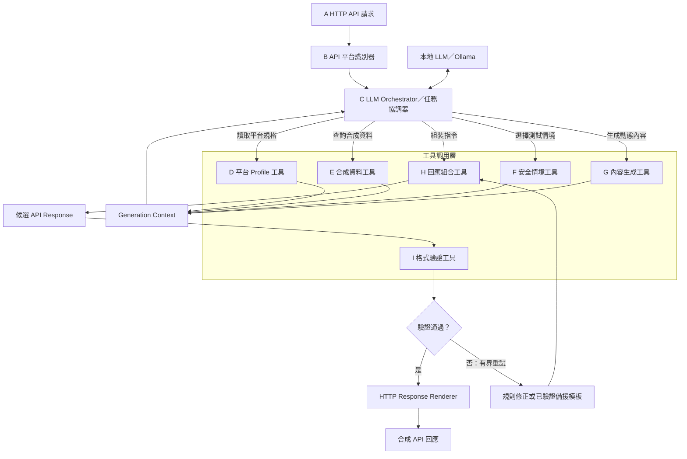

# Mirage_API：跨平台假 API 回應生成器(電商為例)

本專案規劃接收 HTTP API 請求、辨識電商平台、以本地 LLM 與工具組成合成回應，再通過對應網站與版本的契約驗證後渲染。**目前已實作 A 的 FastAPI HTTP 請求入口、D 平台 Profile 建立與查詢工具、格式驗證工具及獨立驗證 API；平台識別、生成、Ollama 協調、修正重試、備援與 HTTP 回應渲染尚未實作。** 下圖是規劃主軸；本文所有「規劃」格式僅定義預期介面，不能當作現有 API 使用。



「合成」是測試資料，不是真實商店資料。契約通過只證明符合**已載入、適用於該網站和版本的規格**，不能單憑此聲稱與官方服務所有行為一致。請只在獲授權的測試環境使用，不要把真實憑證或顧客個資放入提示或樣本。

## 模組、輸入輸出與調用關係

| 節點 | 輸入 → 職責 → 輸出 | 狀態 |
| --- | --- | --- |
| A HTTP API 請求 | method、URL、headers、body → 保留原始 URL、query、追蹤 ID 的標準化請求 | **已實作**：`deception.api.app:app`；保留重複 query／headers 與 body bytes，尚未接上 B/C，預設回 501 |
| B 平台識別器 | 網站 origin、API 前綴、method、path、部署版本 → 唯一平台與 operation；不明時拒絕猜測 | 正式驗證器內已有網站契約匹配；獨立識別器未實作 |
| C 任務協調器與 P Ollama | 識別結果 → 向 D–G 取材、限制 LLM 工具與輪次、指示 H；Ollama 提供本地推論 | 未實作；未選定模型 |
| D 平台 Profile 工具 | 固定來源與 OpenAPI → 可追溯的操作、參數、狀態碼、媒體類型、schema 上下文 | **已實作**：`src/deception/profile_builder/`；提供 CLI 建立及 Python 查詢，尚未接上 C；不推測平台慣例 |
| E 合成資料工具 | 種子、資料規則、關聯 ID → 一致的合成商品、顧客或訂單 | 未實作 |
| F 安全情境工具 | 白名單與請求上下文 → 允許的情境和限制，例如商品不存在／庫存不足 | 未實作 |
| G 內容生成工具 | Profile、合成資料、情境、模型提示 → 動態文字與欄位候選 | 未實作 |
| J Generation Context | D–G 的資料及來源 → 交回 C，記錄平台／契約版本、種子、情境 | 未實作 |
| H 回應組合工具 | C 指令與 J → status、headers、已序列化 body；只使用契約允許欄位 | 未實作 |
| I 格式驗證工具 | 候選 status、headers、body 及原請求 URL／method → `pass`、`reject` 或 `unverifiable` 與錯誤 | **已實作** |
| N 修正或備援 | 驗證錯誤 → 有上限的重新組合；耗盡後用同一契約已驗證的備援 | 未實作；現有驗證器不修正、不重試、不提供備援 |
| M HTTP Response Renderer | 僅接收 `pass` 且 `valid=true` 的同一份回應 → HTTP status、headers、body | 未實作 |

A → B → C；C 分別調用 D/E/F/G，匯成 J，再指示 H 建立 K；I 驗證 K。`reject` 可按錯誤碼做**固定上限**的修正，每次重新驗證。`unverifiable` 表示缺少可信契約或情境，不應由 LLM 補出規格。備援也必須通過 I，否則失敗關閉。重試上限、超時和對外失敗狀態碼仍待設計。通過後 M 必須渲染**完全相同**的 body、status、headers，不得再改動。

## 檔案與輸入資料

```text
Mirage_API/
├─ README.md
├─ pyproject.toml                    # 現有驗證器依賴及測試設定
├─ .env.example                      # MIRAGE_PLATFORMS_DIR 設定提示
├─ src/deception/api/               # A：FastAPI 原生請求入口與標準化介面
├─ src/deception/profile_builder/   # D：來源檢查、Profile 建立與操作查詢
├─ inputs/sources/                  # D：source.yaml 與固定 OpenAPI 輸入
├─ generated/                       # D：自動產生的 profiles 與 schemas 快照
├─ mirage_validator/                 # 已實作的驗證 API、網站契約 gate、PoC 驗證
│  └─ contracts/*.json               # 與正式契約隔離的 PoC 示意契約
├─ inputs/platforms/
│  ├─ woocommerce/
│  │  └─ manifest.yaml.example       # 人工待填範本；不載入
│  └─ medusa/
│     ├─ openapi.yaml                # 使用者提供的 Store／Auth 子集；來源待核實
│     ├─ manifest.yaml.example       # 人工待審範本；不載入
│     ├─ api-scope.json              # 使用者提供的操作範圍；程式不讀
│     ├─ input-audit.json            # 已產生的檢查紀錄；程式不讀
│     └─ README.md                   # 此規格的來源與缺口
├─ fixtures/                         # 現有兩平台 PoC 驗證範例
├─ tests/                            # 現有驗證器測試
└─ docs/                             # 現有 PoC 與網站契約守門員說明
```

**人工必要輸入（啟用網站契約前）**：在 `inputs/platforms/<站點與版本套件>/` 放入經核對的固定版本 `openapi.yaml`（或 manifest 指定檔名）及 `manifest.yaml`；填入精確平台／部署版本、真正的來源 URL 與不可變 revision、規格 SHA-256、實際站點 `base_urls`、已審查的 `query_contexts`。`approved: true` 只能由維護者在來源、部署和適用範圍審查完成後設定；雜湊正確不等於官方或部署相符。只接受打包好的內部 `$ref`，不能讓請求指定本地檔案或自動抓遠端引用。

**D 的人工輸入與系統產物**：提供 `inputs/sources/<platform>/source.yaml` 與同目錄固定規格後，D 產生 `generated/profiles/<platform>.yaml` 和 `generated/schemas/<platform>/<sha256>.yaml`。未審來源可離線預覽，但查詢預設拒絕使用；D 不改寫驗證器的 manifest。下方早期 `inputs/profiles/` 範例仍是生成規則的規劃格式，不是 D 的 parser。情境與種子草稿也尚未接上執行流程。Profile 不能放寬 OpenAPI 回應契約。

**自動生成或選填資料**：未來 E 可從種子產生 `generated/<site>/<run>/products.json` 等合成資料，J 可輸出同一 run 的 context；`samples/` 可保存實測回應供人工比對。樣本不能反推為完整契約。現有 `input-audit.json` 是檢查產物，`api-scope.json` 是範圍紀錄，兩者均不參與驗證執行。

### 現有 manifest 格式示例（未啟用）

```yaml
platform_id: woocommerce
platform_version: REPLACE_WITH_DEPLOYED_VERSION
source_url: https://REPLACE_WITH_VERSIONED_OFFICIAL_SOURCE
source_revision: REPLACE_WITH_TAG_OR_COMMIT
spec_sha256: REPLACE_WITH_64_HEX_SHA256
approved: false
openapi_file: openapi.yaml
base_urls:
  - https://shop.example/wp-json/wc/v3
query_contexts:
  - {}
```

`base_urls` 須吻合實際 origin 與 API 前綴；若 OpenAPI paths 已含 `/store` 等前綴，依規格選 origin，避免重複。不同網站／版本建立不同套件；同站不能同時命中多份。`query_contexts` 明列已審查的參數組合，不會自動推導 `fields` 等參數如何改變回應。`.example` 檔不會被載入。目前沒有可放行的 WooCommerce／Medusa 官方套件。

### 規劃中的 Profile、情境與 context（非現有 parser 格式）

```yaml
# inputs/profiles/woocommerce/<固定平台版本>/profile.yaml（規劃）
platform_id: woocommerce
platform_version: "<固定平台版本>"
operation_id: get_product
response_contract: "<已審查 manifest 與 OpenAPI 的識別值>"
generation_rules:
  synthetic_only: true
  allowed_statuses: [200, 404]
  price_representation: string
```

```yaml
# inputs/scenarios/product_found.yaml（規劃）
scenario_id: product_found
allowed_operations: [get_product]
status_code: 200
synthetic_seed: 42
```

```json
{
  "run_id": "demo-001",
  "site_id": "shop-example",
  "platform_id": "woocommerce",
  "platform_version": "<固定平台版本>",
  "operation_id": "get_product",
  "scenario": "product_found",
  "synthetic_seed": 42,
  "contract_sha256": "<已審查規格雜湊>",
  "candidate": {"status_code": 200, "headers": {"Content-Type": "application/json"}, "body": "{\"id\":101}"}
}
```

`candidate.body` 是最終 UTF-8 JSON 字串；示例商品內容**不足以證明通過官方契約**。Profile、種子、情境、契約雜湊與候選回應需記錄在同一 run 以便重現。站點 ID、平台版本、契約雜湊與 run ID 應隔離資料及快取；不能跨站／跨版本重用前次通過的 body。

## 最小可行平台範圍

| 平台 | 第一個規劃操作 | 人工須提供與核實 | 現況 |
| --- | --- | --- | --- |
| WooCommerce | `GET /wp-json/wc/v3/products/{id}` 的 200／404 | 目標部署版本、對應官方規格或有來源的補充契約、實際站點前綴與查詢上下文；[wc/v3 商品文件](https://developer.woocommerce.com/docs/apis/rest-api/v3/products/) 只作參考，勿與舊 `/wc-api/v3` 混用 | 只有示意 PoC 契約及 manifest 範本 |
| Medusa | 固定版本 Store API 商品讀取的一個 operation 與 200／404 | 固定版本的 [Store API 規格](https://docs.medusajs.com/api/store)、部署 origin、`fields` 等 query 上下文與參考服務對照 | 有使用者提供的 Store／Auth 子集，但來源版本與部署未核實；見[輸入檢查](inputs/platforms/medusa/README.md) |

先讓一個站點、單一 operation 和少數狀態碼形成可驗證閉環，再擴充。`poc-v1` 是本專案示意契約版本，**不是平台版本**。若官方規格未描述動態欄位、外掛、授權或商業規則，維持未涵蓋，另做參考服務對照。

## 已實作的 D：平台 Profile 工具

已先比較 openapi-core、Prance、openapi-pydantic 與 openapi-python-client，選擇重用現有 `openapi-core==0.19.5` 做規格檢查，再建立本專案的 Profile 摘要與查詢，沒有新增依賴。功能範圍與現成方案評估見 [D 說明](docs/profiles.md)。

```powershell
$env:PYTHONPATH = "$PWD/src"
.\.venv\Scripts\python.exe -m deception.profile_builder --source inputs/sources/medusa/source.yaml --output generated
```

目前可從使用者提供的 Medusa 規格建立 77 個 operations；來源仍為 `approved: false`。`ProfileTool.get_operation` 以平台、版本、規格雜湊、method 和 path template 精確查詢，保留 schema 引用與規格缺口。尚未提供來源的 WooCommerce 只有設定範本。

## 已實作的 A：HTTP 請求入口

直接用 FastAPI 接收目標 path，不必把請求包成 JSON。入口與驗證 API 分開啟動：

```powershell
$env:PYTHONPATH = "$PWD/src"
.\.venv\Scripts\python.exe -m uvicorn deception.api.app:app --host 127.0.0.1 --port 8001 --no-proxy-headers
curl.exe -i "http://127.0.0.1:8001/store/products/prod_synthetic_001?fields=id&fields=title" -H "X-Request-ID: demo-001"
```

A 會保留 method、原始 URL／path／query、重複 headers、body bytes 與追蹤 ID，供後續 handler 使用。B/C 尚未接上，預設回 `501 pipeline_not_implemented` 與 `X-Request-ID`；不代表已生成商品回應。body 超過 1 MiB 回 413，無效或重複追蹤 ID 回 400。此入口沒有 `/docs`；驗證 API 的 `/docs` 維持原樣。詳見 [入口介面與部署方式](docs/ingress.md)。

## 已實作的 I：格式驗證 API

`POST /v1/validate` 接受原請求定位資訊與**候選最終回應**，不生成回應。下例 `shop.example` 是占位網站；在沒有已核准契約時，預期 `unverifiable`，不是成功範例：

```json
{
  "request_url": "https://shop.example/wp-json/wc/v3/products/101",
  "request_method": "GET",
  "status_code": 200,
  "headers": {"Content-Type": "application/json"},
  "body": "{\"id\":101}"
}
```

把以上內容存為 `request.json` 後，以 PowerShell 呼叫：

```powershell
curl.exe -X POST http://127.0.0.1:8000/v1/validate -H "Content-Type: application/json" --data-binary "@request.json"
```

若站點未綁定，結果形式為：

```json
{
  "valid": false,
  "decision": "unverifiable",
  "validation_basis": "loaded_openapi_contract",
  "platform_id": null,
  "platform_version": null,
  "operation_id": null,
  "spec_sha256": null,
  "errors": [{"location": "contract", "path": "", "code": "site_not_unique", "reason": "網站沒有契約綁定，或同時匹配多份契約", "schema_path": null}]
}
```

`headers`、`status_code`、`body` 均屬**待驗證回應**，與驗證 API 自己的 HTTP headers／status 無關。驗證 API 對契約通過或失敗通常都回 200；必須檢查 `decision` 與 `valid`。輸入模型錯誤回 422。`pass` 且 `valid=true` 才可放行；`reject` 是已選契約的違規；`unverifiable` 是契約未載入／未核准、匹配歧義、上下文未審查或驗證器無法確認。

`errors[]` 有 `location`（`contract`／`status`／`headers`／`body`）、相對於該位置的 RFC 6901 JSON Pointer `path`（空字串為根）、機器可讀 `code`、人類可讀 `reason`、可用時的 `schema_path`。規則錯誤例如 `type`、`required`；缺少契約可為 `site_not_unique`，未審查 query 可為 `unsupported_context`，無效 JSON 可為 `invalid_json`。原因文字可能由套件產生，不宜依其字串分支。現有 gate 僅支援 JSON body 和單值 headers；無 body schema、非 JSON、多值 headers、未審查 query 等情況不能放行。

隔離的示意入口 `POST /v1/poc/validate` 使用 `mirage_validator/contracts/*.json`，可用 `fixtures/` 試驗型別、欄位與狀態碼錯誤；**不代表官方相容性**。見 [PoC 用法](docs/poc.md) 與 [網站契約守門員](docs/gate.md)。正式入口不會退回 PoC 契約。

## 安裝、執行與測試現有驗證器

需要 Python 3.11+。在專案根目錄以 PowerShell 執行；以下只啟動**現有驗證 API**，不啟動 Ollama 或整套生成流程：

```powershell
python -m venv .venv
.\.venv\Scripts\python.exe -m pip install -e ".[test]"
$env:MIRAGE_PLATFORMS_DIR = "$PWD/inputs/platforms"
.\.venv\Scripts\python.exe -m uvicorn mirage_validator.api:app --reload
```

另開終端機：

```powershell
.\.venv\Scripts\python.exe -m pytest -q
curl.exe -X POST http://127.0.0.1:8000/v1/poc/validate -H "Content-Type: application/json" --data-binary "@fixtures/woocommerce_200_valid.json"
```

可開啟 `http://127.0.0.1:8000/docs` 查看現有 API。`.env.example` 不自動載入；平台目錄預設是工作目錄下的 `inputs/platforms`，正式部署建議指定絕對路徑。更新 manifest／規格後須重啟。載入的規格雜湊不符或規格無效會使啟動失敗。用 `Get-FileHash <規格檔> -Algorithm SHA256` 計算雜湊；雜湊只證明檔案一致性。

## 契約、版本與狀態隔離

- 正式 gate 依 `base_urls` 唯一匹配網站，再依 method、path、已審查 query、status、Content-Type 找規格。未知、重疊或未核准套件一律不放行。
- 正式 gate 使用 `openapi-core==0.19.5` 驗證 OpenAPI 3.0／3.1；這是鎖版內部擴充點，升級需重新檢查原始 JSON 型別和 headers。PoC 另用 `jsonschema` 驗證自訂 Draft 2020-12 契約，不能混作正式放行依據。
- 生成系統未來須以站點 ID、平台版本、規格雜湊、情境、run ID 隔離資料與快取。一次候選只用一份明確契約；禁止跨版本自動回退，禁止把前次通過的 body 配上新 status／headers。
- 格式 gate 只能檢查規格明示的結構及 HTTP metadata，不能驗證商品事實、庫存邏輯、外掛行為或所有授權差異。規格或部署變更後須重新審查與對照。

## 開源軟體、模型與資料授權

以下按本 repo 的 `pyproject.toml` 和上游授權資料區分。**採用**是現有直接依賴，**規劃／可選**未集成，**未採用**沒有引入。連結指向上游授權或官方資料；發行前仍須按實際鎖定版本及間接依賴逐項核對。

| 類別 | 專案 | 上游授權／來源 | 用途與界線 |
| --- | --- | --- | --- |
| 採用 | [FastAPI](https://github.com/fastapi/fastapi/blob/master/LICENSE) | MIT | 現有驗證 API |
| 採用 | [Pydantic](https://github.com/pydantic/pydantic/blob/main/LICENSE) | MIT | 嚴格輸入／輸出模型 |
| 採用 | [openapi-core](https://github.com/python-openapi/openapi-core/blob/master/LICENSE) | BSD-3-Clause | 正式 OpenAPI 驗證；保留版權、授權與免責聲明，不用作者名稱背書 |
| 採用 | [jsonschema](https://github.com/python-jsonschema/jsonschema/blob/main/COPYING) | MIT | 僅 PoC 自訂契約；發行時核對實際版本 |
| 規劃 | [Ollama](https://github.com/ollama/ollama/blob/main/LICENSE) | MIT，限此**程式碼** | 圖中的本地推論服務；模型權重有各自條款，不能從 Ollama 授權推定模型可商用或再散布 |
| 可選 | [Pydantic AI](https://github.com/pydantic/pydantic-ai/blob/main/LICENSE) | MIT | 可協助 C 的工具調用；目前未依賴 |
| 可選 | [Faker](https://github.com/joke2k/faker/blob/master/LICENSE.txt) | MIT 型授權文本 | 可供 E 生成合成資料；仍需核對資料來源 |
| 可選 | [Prism](https://github.com/stoplightio/prism/blob/main/LICENSE) | Apache-2.0 | 外部 mock 比對，不是現有 H／I |
| 可選 | [Schemathesis](https://github.com/schemathesis/schemathesis/blob/master/LICENSE) | MIT | 契約測試；通過仍不等於官方行為一致 |
| 未採用 | [WireMock](https://github.com/wiremock/wiremock/blob/master/LICENSE.txt) | Apache-2.0 | 可作替代 mock server；目前無依賴 |
| 參考資料 | [WooCommerce REST API 文件](https://developer.woocommerce.com/docs/apis/rest-api/v3/products/)／[外掛授權標示](https://github.com/woocommerce/woocommerce/blob/trunk/plugins/woocommerce/readme.txt) | 文件、程式碼與範例權利須分開核對；外掛標示 GPLv3+ | 僅參考 API 行為，未複製其程式碼。閱讀 GPL 專案文件不會使獨立實作自動受 GPL 約束；若複製程式碼或大量文件，須另評估 |
| 參考資料 | [Medusa Store API 文件](https://docs.medusajs.com/api/store)／[核心授權](https://github.com/medusajs/medusa/blob/develop/LICENSE) | 核心儲存庫除企業版材料外為 MIT；企業版另有條款 | 現有輸入規格由使用者提供，來源與再散布權未核實；發行前核對固定版本的規格及文件授權 |

`pyproject.toml` 還列有 `uvicorn`、`PyYAML`、`werkzeug`，測試 extra 有 `pytest`、`httpx`；它們及**間接依賴**也須按實際分發版本納入第三方清單。上表不是完整 SBOM，也未替 Mirage_API 原始碼選定授權；目前根目錄沒有 `LICENSE`，不可暗示本專案已用某種開源授權發布。

內部執行與提供軟體、容器、模型或規格給他人，所涉義務可能不同。分發時依實際包含元件保存 MIT／BSD／Apache 等授權與版權聲明；Apache-2.0 元件若帶 `NOTICE`，按條款保留適用內容並標示修改。README 簡表不能替代授權檔與 NOTICE。另核對模型權重的使用／商用／再散布條款，以及下載或打包的 API 規格、範例、文件的個別權利。不要把「依賴某個 LGPL／GPL 程式」直接等同整個獨立專案必須改用該授權；若未來引入其程式碼或連結／分發該元件，按**具體版本、整合方式與分發形式**評估並履行義務。
