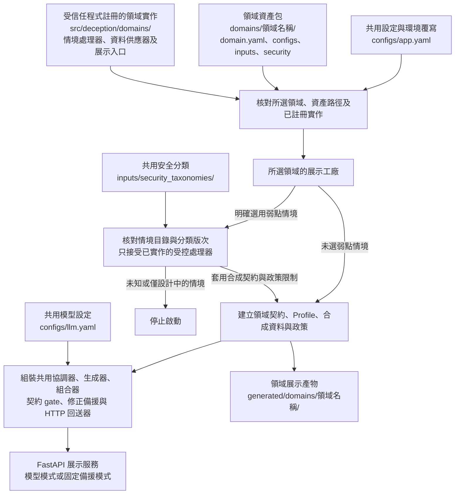
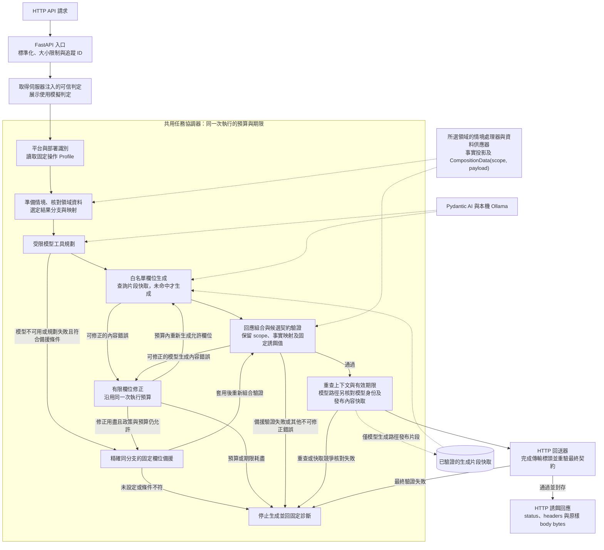

# 詳細架構與執行邊界

整體目的與工具分工先看 [README 架構總覽](../README.md#系統架構)。本頁補充啟動組裝、每次請求的執行步驟、快取與失敗處理，供設定部署或查閱程式時使用。

領域資產位置與插件介面見 [領域設定](domains.md)；資料投影格式見 [共用資料交換](common-data.md)。

## 領域載入與啟動組裝

此圖對應共用展示入口 `deception.api.demo:create_app`。正式部署也可由自己的組裝程式建立元件，再注入 `deception.api.pipeline.create_app`。

弱點情境在啟動時由管理者選定。展示工廠先把固定誘餌值及必要標頭等限制加入合成契約，再建立規格摘要與 Profile，並將固定值套入相應政策；目前沒有依訪客請求自動偵測 OWASP 類別或切換弱點的功能。未知領域、資產越界及不符設定也會停止啟動。

## 每次請求的生成與回送

下圖呈現完整 HTTP 接入的共用流程。虛線表示領域供應器、模型服務或內容快取的資料依賴；外部系統的來源認證由部署整合負責，隔離展示則明確注入 `simulated_malicious` 模擬判定。

組合器接收領域供應器已核對的 `CompositionData`，不限定商品或變體根節點。快取只保存生成片段，命中時仍須經過本次身份、情境、模型規劃及回應驗證；發布競爭若取得另一份勝出值，會重新組合並驗證。固定備援不寫入模型內容快取，也必須通過相同的組合、契約及最終 HTTP 驗證。

圖中修正僅處理允許的生成欄位；模型不可用或規劃失敗時，符合條件才直接選固定備援，不進入欄位重新生成迴圈。來源、身份、HTTP metadata、資料、判定關聯或期限不符時會停止，不能透過修正或備援放行。部署代理接入、遠端判定來源認證、集中設定及交易狀態更新仍列於下方「驗證與目前邊界」，未畫成已實作元件。

## 驗證與授權

本頁整理既有元件，沒有新增工具、套件或模型。設定與呼叫範例見 [Docker 與展示入口](docker.md)，功能驗證見 [HTTP 驗證工具](verification.md)。維護本頁後執行 `python tools/check_documentation.py`，並核對圖示與對應程式的執行順序；文件檢查不代替實際功能測試。

套件、模型與來源資料授權沿用 [專案授權清單](../README.md#開源軟體模型與資料授權)；OWASP 分類及領域映射另見 [分類說明](owasp-design.md)。
