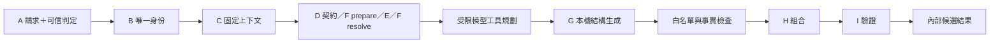

# C／G：本地 LLM 協調與動態內容生成

## 專案目的與分工

C／G 將現有 D／E／F／H／I 串成受控的本地 LLM 生成流程。C 負責工具與流程，G 實際呼叫本機模型產生內容；契約、情境與資料事實仍保留各自來源。主要函式、模型及邊界檢查附有中文功能註解。

| 模組 | 職責 | 保留的邊界 |
| --- | --- | --- |
| C 協調器 | 核對請求與部署身份、取得固定契約、選情境、準備生成上下文、限制模型與工具呼叫、檢查輸出並交給 H／I | 模型的建議不會替代來源核准、身份核對或最終驗證 |
| G 生成器 | 依本次契約、資料事實、情境與白名單，產生結構化的內容片段 | 只有明確允許的位置可由模型填入 |
| J 生成上下文 | 綁定領域、請求指紋、部署、契約、資料與政策、模型／提示版本 | 同一次生成使用同一組身份與版本 |
| D／E／F | 分別提供固定契約、已核對的合成資料與情境結果 | C／G 不提升 `approved` 或重新標記既有 E 資料集 |
| H／I | 組合與序列化候選，驗證原樣交接的 status、headers、body 及原始請求 URL | 通過的候選仍由後續 M 負責正式 HTTP 輸出 |

目前內建領域為 `ecommerce`。領域政策明寫 `domain: ecommerce`，平台另以 `platform_id`、版本及規格 SHA-256 選擇；電商與 Medusa／WooCommerce 是不同層級。共用 C／G 流程不依商品名稱猜測領域。新增完整領域時，仍須提供相應的情境處理器、資料來源與生成政策。

## 必經流程與模型權限

本次請求先由 B 識別，再由 D 取得固定 operation；F 的 `prepare` 決定固定 family scope，呼叫端依核對的設定建立或讀取 E，F 的 `resolve` 才依同一資料決定結果。模型工具規劃與 G 的結構化生成在這些身份及事實之內進行。合併後必須經 H 組合及 I 驗證。



外部系統負責攻擊判定及來源認證。`AttackAssessment` 的來源 ID 白名單只限制可接受的來源標籤；接收層須先完成服務身份驗證，不能把訪客提供的 `trusted: true` 或 header 當作認證。C／G 沒有新增公開 verdict 接收 API。

生成政策由伺服器載入，明列允許的目標位置及 schema。請求內容與模型輸出都是待核對資料；模型不能選用另一個部署、run、契約或任意檔案／網路工具。錯誤時保持不可產生已驗證候選的結果，不由模型自行宣告通過。模型呼叫、工具嘗試及修正都受總預算與整體期限限制。

本機工具規劃與結構化生成分別呼叫模型。Ollama 官方支援 [tool calling](https://docs.ollama.com/capabilities/tool-calling) 及 [JSON Schema structured outputs](https://docs.ollama.com/capabilities/structured-outputs)；實際可用性仍依鎖定的伺服器、adapter 與模型實測。程式的必經檢查不依賴模型是否遵守工具選擇指令。

## 事實、生成內容與一致性

| 資料類型 | 來源與處理 |
| --- | --- |
| 商品 ID、既有名稱、價格、庫存及父子關聯 | 使用已核對的 E 資料及明確映射，保持原值 |
| 情境、status、method、path、scope、契約身份 | 使用 F／政策與 B／D 的結果 |
| 描述、錯誤細節與受限物件 | 僅在生成政策列出的欄位內由 G 產生，並檢查型別與 schema |
| 跨請求需要穩定的衍生內容 | 依實體、資料、契約、政策及模型／提示版本隔離保存，不寫回 Faker 產物 |

生成位置不能與受保護資料映射重複或有父子重疊。模型回傳其他位置、額外欄位、錯誤原始 JSON 型別、過長值或不符合允許 schema 的內容，都須拒絕；不能用任意 JSON Patch 改整份計畫。JSON Schema 生成約束不等於完整平台契約或業務事實驗證，最後仍以原本 D 契約經 H／I 檢查。

G 僅投影明確支援的局部 schema 子集：基本型別、物件屬性、陣列項目、列舉、長度與數值限制，以及有深度上限的內部引用。不支援的複合限制、循環或帶結構覆寫的引用鏈會拒絕，不能在解引用時丟掉中間限制。原始 OpenAPI 3.0／3.1 契約保持不變，H／I 仍檢查最終組合的完整回應。

解碼器的各生成欄位以 `WithJsonSchema` 完整替換為該局部 schema，避免把型別／長度等限制放在通用 `JsonValue` 的 `$ref` sibling 旁，導致部分解碼器忽略限制。收到的 JSON 仍以白名單欄位的原始型別及 schema 驗證，再由 H／I 檢查完整候選；生成約束不取代這些檢查。

內容以整條生成規則為單位原子發布，因此同一條規則的欄位必須使用相同的 `cache_scope` 與 `entity_pointer`；首版拒絕混合 request／entity 快取或多個實體來源。快取鍵包含領域、部署、run scope、資料快照、F／G 政策、回應骨架、事實投影、欄位 schema、提示及模型身份。SQLite 的唯一鍵採先成功發布者的值；競爭者使用勝出內容重新經 H／I 驗證，追溯摘要對應實際候選，而不是被放棄的生成值。快取保存的是已驗證內容，不保存可供其他請求直接重用的 gate 通行結果。

E 目前是可重建的唯讀商品／變體快照。C／G 尚未實作購買扣款、庫存更新、退款或訂單狀態交易；這些功能需要 E 的交易、去重、併發及狀態版本介面。Agent memory、對話歷史或回應快取都不能代替該交易狀態。

## 現成專案與採用取捨

| 專案 | 能力 | 本次決定及程式授權 |
| --- | --- | --- |
| [Pydantic AI](https://pydantic.dev/docs/ai/models/ollama/) | 型別化工具、依賴注入、結構化結果與本機 Ollama 整合 | 採用於模型介面；[MIT](https://github.com/pydantic/pydantic-ai/blob/main/LICENSE) |
| [Ollama](https://docs.ollama.com/capabilities/structured-outputs) | 本機推論、工具與 JSON Schema 輸出 | 本機模型服務；[MIT](https://github.com/ollama/ollama/blob/main/LICENSE) |
| [Galah](https://github.com/0x4D31/galah) | Go 的 LLM 動態 HTTP 誘餌、Ollama 及回應快取 | 僅參考公開的提示、生成及快取設計，沒有引入 Go runtime 或複製程式碼；[Apache-2.0](https://github.com/0x4D31/galah/blob/main/LICENSE) |
| [LangGraph](https://docs.langchain.com/oss/python/langgraph/overview) | 顯式狀態圖、checkpoint 與恢復 | 未採用，保留作複雜流程備選；[MIT](https://github.com/langchain-ai/langgraph/blob/main/LICENSE) |
| [Instructor](https://python.useinstructor.com/integrations/ollama/) | 型別化生成、輸出驗證及重試封裝 | 未採用，避免同一流程疊加兩套重試控制；[MIT](https://github.com/567-labs/instructor/blob/main/LICENSE) |
| [Outlines](https://dottxt-ai.github.io/outlines/latest/features/models/ollama/) | 多種模型 backend 的結構輸出 | 未採用，首版使用本機 Ollama 的結構生成能力；[Apache-2.0](https://github.com/dottxt-ai/outlines/blob/main/LICENSE) |

`pydantic-ai-slim[openai]` 使用相容協定連接本機 Ollama，不表示將請求送往 OpenAI 雲端。服務位址與模型只從受信任設定取得。也不能從本機 Ollama 的結構輸出能力推定 Ollama Cloud 有相同支援。

## Python 內部 API 與離線展示

`DeceptionOrchestrator` 位於 `deception.core.orchestrator`，接收已由伺服器建立的 B／D／F／G／H／I 工具。下面的 `identifier`、`profiles`、`scenarios`、`composer` 與 `gate` 均為已核對設定的工具實例；`verified_assessment` 是接收層完成來源認證後的判定，不能直接使用訪客提供的 JSON。

```python
from pathlib import Path

from deception.core.orchestrator import DeceptionOrchestrator
from deception.generation import ContentCache, ContentGenerator, GenerationPolicy
from deception.llm import LLMConfig, PydanticAIBackend
from deception.profile_builder.builder import read_yaml

llm_config = LLMConfig.model_validate(read_yaml(Path("configs/llm.yaml").read_bytes()))
policy = GenerationPolicy.model_validate(
    read_yaml(Path("reviewed-generation.yaml").read_bytes())
)
backend = PydanticAIBackend(llm_config)
cache = ContentCache(Path("generated/generation/content.sqlite3"))
generator = ContentGenerator(policy, backend, cache=cache)
pipeline = DeceptionOrchestrator(
    identifier=identifier, profiles=profiles, scenarios=scenarios,
    generator=generator, composer=composer, gate=gate,
)

async def run_once():
    try:
        result = await pipeline.run(
            request, verified_assessment, runtime=trusted_runtime,
            generation_config=checked_e_config, dataset=checked_e_dataset,
        )
        # validated 表示內部候選通過 I；後續 M 仍須使用完全相同的候選。
        return result
    finally:
        await backend.aclose()
        cache.close()
```

`dataset=None` 時，內建電商資料供應器會依明確的 E 設定生成；提供快照時則以該完整設定重建檢查。F、生成政策與資料供應器須使用同一領域；其他領域可注入自己的 `load`、`facts`、`composition_data` 介面。`PipelineResult` 區分 `validated`、`not_applicable`、`unverifiable` 與 `reject`，失敗結果沒有可對外使用的候選。

可先執行獨立的真本機模型展示：

```powershell
$env:PYTHONPATH = "$PWD/src"
.\.venv\Scripts\python.exe -m deception.generation --demo --domain ecommerce --llm-config configs/llm.yaml --output generated
```

命令只接受 `execution_mode: local`，不注入 `FunctionModel`，服務或模型不符時明確失敗。`configs/llm.yaml` 預設使用本機已安裝的 **Foundation-Sec-8B-Reasoning Q4_K_M GGUF**：完整 Ollama 名稱為 `hf.co/fdtn-ai/Foundation-Sec-8B-Reasoning-Q4_K_M-GGUF:Q4_K_M`，本次核對 digest 為 `77a78066847b2002fd602955667bd26857eb2cb751c6ed2e975c21b4a826b0a5`。這是 Reasoning 量化變體，不等同於基礎 `Foundation-Sec-8B` 或全部 Foundation 系列模型。換模型或更新權重時須同步核對設定與權重授權。`inputs/policies/generation.yaml` 則是停用的 C／G 政策範本，與 E 的 `configs/generation.yaml` 分開；展示自行建立隔離的合成契約及政策，不能把它的精簡商品 body 當成完整 Medusa 契約。

可先列出本機已安裝且未標示 cloud／remote 的模型，不需指定展示或領域：

```powershell
.\.venv\Scripts\python.exe -m deception.generation --list-models
```

展示時可明確選另一個已安裝的完整名稱：

```powershell
.\.venv\Scripts\python.exe -m deception.generation --demo --domain ecommerce --model "qwen2.5-coder:7b" --output generated
```

`--model` 會從本機 `/api/tags` 唯一選取名稱，將讀到的完整 digest 固定於本次設定；`--model-digest <完整SHA256>` 可再加上呼叫端要求的核對。省略 `--model` 時，仍須與 `configs/llm.yaml` 原先固定的 digest 相同，模型 tag 改變不會自動獲得接受。這些操作只有受限 loopback metadata GET，不下載缺少的模型、不中途切換雲端模型，也不從任意 URL 查模。

Python 呼叫端可從 `deception.llm.selection` 匯入函式，以 `await list_local_models(config)` 列模，或 `await select_local_model(config, model_name, expected_digest=...)` 建立固定選擇，再交給 `PydanticAIBackend`。模型清單表示已安裝，不代表該模型已通過工具規劃或內容品質驗證；每個實際模型組合仍須另跑展示及測試。

展示依次查詢存在商品、不存在商品及同一存在商品，要求狀態為 `200 → 404 → 200`、每次 I 通過、E 與商品權威欄位不變、兩次商品 body 完全相同。每次展示建立新持久快取檔，要求前兩次 G 實際生成，第三次重用同實體內容。結果保存於 `generated/generation/<報告SHA256>.json`，SQLite 位於 `generated/generation/cache/`；生成流程回傳失敗時也保存局部診斷報告並回非零結束碼，設定或選模的前置檢查錯誤則直接拒絕開始。報告的 `real_model` 只在實際 trace 確認本機模型身份後才為 true，不能將執行模式設定本身當作實測成功證據。

## 本機模型與共用執行預算

`deception.llm.LLMConfig` 區分 `execution_mode: local` 與 `test`。本機模式要求明確模型名稱與 64 字元 SHA-256 digest，僅接受 `http://127.0.0.1:<port>/v1`、`localhost` 或 IPv6 loopback 的 Ollama 相容位址。含 cloud 的模型名稱、非本機 endpoint、URL 帳密、query 或 fragment 都會拒絕。

`PydanticAIBackend.check_ready` 讀取本機 `/api/tags` 與 `/api/version`，確認所選模型唯一存在、digest 相同、metadata 沒有 remote model／host 標記，並記錄 runtime 版本。本機模式在 run 起始、每次推論前後及內容發布前核對身份，避免生成期間模型別名指向另一份權重而沿用舊摘要。欄位別名在框架回傳後仍以同一批對外 field ID 嚴格核對。本機 client 關閉環境代理、redirect 與 SDK 自動重試；模型服務不存在或身份不符就不能當成本機生成成功。

測試模式必須明確注入 planner 與 generator 的 Pydantic AI 模型；本機模式拒絕注入測試模型。`planner_mode: native_tools` 使用原生工具呼叫與型別化輸出工具；`structured_actions` 則由 Pydantic AI 產生受限 JSON 動作，再由 C 執行已註冊的唯讀工具及步驟檢查，適用沒有原生 tools 能力的模型。預設 Foundation Reasoning 變體採 `structured_actions`，不能將普通文字中的工具描述誤認成原生工具呼叫成功。

G 使用 `NativeOutput`，規劃及內容生成保留獨立 Agent／對話歷史並共用同一個 `RunBudget`。CLI 選另一個模型時沿用設定的 `planner_mode`；需要原生工具模式時，明確使用另一份已審 `--llm-config`。backend 可用 `await backend.aclose()` 明確釋放連線。

| `RunLimits` 設定 | 預設 | 行為 |
| --- | --- | --- |
| `timeout_seconds` | 120 秒 | 從 C 建立預算起算，包含各階段及有限修正 |
| `max_model_requests` | 8 | 每次模型呼叫前計數，失敗也消耗額度 |
| `max_tool_calls` | 8 | 函式工具嘗試計數，包含未知名稱或無效參數；結構輸出工具另由模型請求額度約束 |
| `max_input_tokens` | 32000 | 依模型回報累積，超額回應不交給下一階段 |
| `max_output_tokens` | 4096 | 同一 run 依模型回報累積輸出用量 |
| `max_repairs` | 1 | 整個生成流程共用的修正上限 |

`LLMConfig.max_output_tokens` 另限制單次模型輸出，預設 512；它與全 run 的輸出額度不同。token 額度依服務回報核對，不是執行前精確計算未知模型的 token 數。同步的契約、資料及組合工作在主要階段前後檢查同一單調時鐘期限；期限已過的結果不能繼續宣告成功，並不承諾能在任意同步程式中途強制中斷。

C 在內容發布前及最終返回前重新核對 F 期限、同一決策摘要及請求指紋；發布等待或競爭勝出內容的再次驗證，都不能讓已過期的判定取得 `validated`。G 欄位 schema 或 H 組合失敗可在共用修正上限內重新生成；I 未通過時保持失敗，不讓模型改寫契約身份或自行宣告成功。

## 套件、模型與資料授權

本次安裝的模型介面為 `pydantic-ai-slim[openai]==2.66.0`。下表按本次環境的 distribution metadata 與隨附授權檔核對；除 `pyproject.toml` 明確鎖定者外，間接依賴版本只是本次驗證快照。

| 套件 | 本次版本 | 授權 | 用途 |
| --- | --- | --- | --- |
| [pydantic-ai-slim](https://github.com/pydantic/pydantic-ai/blob/v2.66.0/LICENSE) | 2.66.0 | MIT | C 的受限工具規劃與 G 的結構輸出 |
| [pydantic-graph](https://github.com/pydantic/pydantic-ai/blob/v2.66.0/LICENSE) | 2.66.0 | MIT | Pydantic AI 的框架依賴 |
| [Pydantic](https://github.com/pydantic/pydantic/blob/main/LICENSE)／[pydantic-core](https://github.com/pydantic/pydantic-core/blob/main/LICENSE) | 2.14.3／2.50.4 | MIT | 嚴格上下文、政策、生成片段與輸出模型 |
| [OpenAI Python SDK](https://github.com/openai/openai-python) | 3.46.0 | Apache-2.0 | 只作本機 Ollama 相容協定的 client |
| [HTTPX2／HTTPCore2](https://github.com/pydantic/httpx2) | 2.16.0／2.16.0 | BSD-3-Clause | 新模型 client 的 HTTP 傳輸依賴 |
| [AnyIO](https://github.com/agronholm/anyio) | 4.16.0 | MIT | 非同步執行與取消的共用依賴 |
| [griffelib](https://github.com/mkdocstrings/griffe) | 2.4.1 | ISC | 工具簽章及 docstring 解析依賴 |
| [genai-prices](https://github.com/pydantic/genai-prices) | 0.2.1 | MIT | 框架價格資料介面依賴，不代表本機推論必須使用付費服務 |
| [OpenTelemetry API](https://github.com/open-telemetry/opentelemetry-python) | 1.45.2 | Apache-2.0 | 框架追蹤 API 依賴 |
| [Logfire API](https://github.com/pydantic/logfire) | 5.5.0 | MIT | pydantic-graph 的 API 依賴 |
| [tiktoken](https://github.com/openai/tiktoken) | 0.14.0 | MIT | 相容 client 的 token 工具依賴 |
| [jiter](https://github.com/pydantic/jiter) | 0.19.0 | MIT | 相容 SDK 的 JSON 解析依賴 |
| [typing-inspection](https://github.com/pydantic/typing-inspection)／[typing-extensions](https://github.com/python/typing_extensions) | 0.4.5／4.16.0 | MIT／PSF-2.0 | 型別資訊處理與相容層 |
| [truststore](https://github.com/sethmlarson/truststore) | 0.10.5 | MIT | HTTPX2 的系統憑證依賴 |
| [regex](https://github.com/mrabarnett/mrab-regex) | 2026.11.7 | Apache-2.0 AND CNRI-Python | tiktoken 的正規表達式依賴 |
| [Requests](https://github.com/psf/requests) | 2.34.2 | Apache-2.0 | tiktoken 安裝帶入的 HTTP 依賴，隨包包含 NOTICE |
| [SQLite](https://www.sqlite.org/copyright.html) | 3.45.3 | Public Domain | Python `sqlite3` 使用的引擎，保存已驗證內容；Python wrapper 另隨 Python 授權管理 |

本輪沒有安裝 `ollama` Python SDK；本機服務由 Pydantic AI／相容 SDK 連接。Ollama runtime 是獨立程式，其 [MIT 授權](https://github.com/ollama/ollama/blob/main/LICENSE) 與安裝版本另行管理。既有測試用 HTTPX 0.28.1（BSD-3-Clause）仍與 HTTPX2 分開存在，不能把兩個 distribution 的版本或授權檔互換。

Python 標準庫的 `asyncio`、`hashlib`、`json`、`pathlib` 等隨 Python 提供，依 Python 的 PSF 授權及隨附聲明管理。本表列出模型路徑的直接與主要間接套件，不是完整 SBOM；其餘遞迴依賴及實際打包內容仍須依安裝／發布版本核對。`logfire-api` 的 MIT 以本次 distribution metadata 及上游專案核對，該 distribution 沒有單獨附帶 LICENSE 檔。

Pydantic AI 及 Ollama 的 MIT 是程式碼授權，模型權重、tokenizer、下載資料及提示素材有各自條款。模型須另外記錄識別值與授權；不能因透過 Ollama 執行就推定權重同樣為 MIT，或推定可再散布。

預設權重精確對應 [Foundation-Sec-8B-Reasoning-Q4_K_M-GGUF 模型卡](https://huggingface.co/fdtn-ai/Foundation-Sec-8B-Reasoning-Q4_K_M-GGUF)。其 metadata 標示 `license: other`，內文寫 Apache-2.0；追溯到 [原 Reasoning 模型的 NOTICE](https://huggingface.co/fdtn-ai/Foundation-Sec-8B-Reasoning/blob/main/NOTICE.md)，它明確區分：底層 Meta Llama 3.1 適用 **Llama 3.1 Community License**，Cisco 的修改部分適用 **Apache-2.0**。因此本專案將這份量化權重記錄為含底層及修改部分條款的衍生模型，不把整份權重簡化成純 Apache-2.0，也不將它混同於基礎 Foundation 模型的授權標示。

模型使用與分發應保留對應權重、tokenizer 的原 LICENSE／NOTICE，並核對 [Meta Llama 3.1 授權](https://github.com/meta-llama/llama-models/blob/main/models/llama3_1/LICENSE) 及其 [使用政策](https://github.com/meta-llama/llama-models/blob/main/models/llama3_1/USE_POLICY.md)。其中分發／提供包含材料的產品或服務涉及授權副本、歸屬聲明及 Built with Llama 標示，模型衍生名稱與大型服務的額外條件亦依原條文處理；不能以 Ollama runtime 的 MIT 取代這些權重條款。本輪只選既有安裝，不下載或重新分發權重。

共用 D／E／H／I 的 Pydantic、PyYAML、Faker、openapi-core、Werkzeug 與 schema 驗證依賴沿用 [E 套件說明](synthetic.md)、[H 套件說明](composer.md) 及 [F 套件說明](scenarios.md)。採用與未採用的候選必須分開；僅研究 Galah 不會讓它成為執行期依賴。

分發第三方元件時，保存實際包含版本的 LICENSE、版權、免責聲明及適用的 NOTICE；此文件不替 Mirage_API 原始碼選定授權，也不核准 API 規格、模型或資料的再散布。

## 有效性驗證與目前限制

有效性必須分開記錄兩類證據：

1. 使用 Pydantic AI `FunctionModel` 等可注入模型的測試，驗證真正的 Agent 工具流程、結構輸出、白名單、保護欄位、scope／請求關聯、預算與故障分支。
2. 使用本機 Ollama 與固定模型的實際生成，確認模型確實執行，記錄模型版本、首次及修正後通過率、工具次數、延遲與失敗原因。

假模型測試通過、或真模型測試因服務不存在而跳過，都不能當成實際模型生成已有效的證據。測試用合成契約的核准只存在於隔離的展示／測試目錄，不改動 repo 的 Medusa 審查狀態。

```powershell
.\.venv\Scripts\python.exe -m pytest tests/test_generation.py tests/test_orchestrator.py tests/test_model_selection.py -q
```

此命令主要驗證可控 `FunctionModel` 的邊界與流程；真 Ollama 展示另用前述 CLI，實測結果應依各份報告的 `success`、`real_model`、`checks`、候選與用量判讀。模型品質仍需更多樣本、不同輸入與延遲統計，不以單次合成展示宣稱完整官方平台相容。

本輪輸出是經 H／I 檢查的內部候選結果；M 與完整正式 HTTP 回送尚未實作。A 目前會在 handler 之後追加 `X-Request-ID`，後續 M 串接時必須一併處理最終 headers 與驗證候選一致的要求。

現有 `configs/generation.yaml` 的舊契約 hash 與 `product-found` scope 不能直接套到目前固定來源及 `product-lookup` family。正式資料載入須核對本次 D 與 F scope，不自動重標既有資料或提升 Medusa `approved`。

## 本次真本機模型展示證據（2026-11-08）

在 Ollama **0.17.1** 上，以 Pydantic AI **2.66.0**、`planner_mode: structured_actions`、temperature **0.0**、單次輸出上限 **1024 tokens**，完成下列兩次實際模型展示。兩份報告的 `success`、`real_model` 均為 true，且模型身份明確為 local／ollama。

| 模型選擇 | 固定權重摘要 | 本次本地報告 |
| --- | --- | --- |
| 預設 `hf.co/fdtn-ai/Foundation-Sec-8B-Reasoning-Q4_K_M-GGUF:Q4_K_M` | `77a78066847b2002fd602955667bd26857eb2cb751c6ed2e975c21b4a826b0a5` | `generated/generation/2a582e1f190d2fdc7f1a6c98efe8e34efc96199c2dd96b0b8853dcebd69d30af.json` |
| CLI 選取 `qwen2.5-coder:7b`，沿用 structured actions | `dae161e27b0e90dd1856c8bb3209201fd6736d8eb66298e75ed87571486f4364` | `generated/generation/5bfb18314ca925dd6ab2d042f5d0a52fe327b7ae6d853d1e2c2132aa44167741.json` |

兩次展示都依序得到 **200 → 404 → 200**，每次候選均由 I 回 `pass`／`valid: true`；前兩次 `cache_hit: false`，第三次 `cache_hit: true`。E 快照與商品 ID／名稱保持不變，同一商品的兩次完整 body 相同。第三次仍執行 C 的模型規劃，但 G 的商品描述重用第一次已驗證內容。

| 模型／案例 | 狀態 | 模型請求／工具次數 | 輸入／輸出 tokens | 該次 run 經過時間 |
| --- | --- | --- | --- | --- |
| Foundation／存在商品 | 200 | 5／3 | 1899／103 | 6843 ms |
| Foundation／不存在商品 | 404 | 5／3 | 1712／84 | 5249 ms |
| Foundation／再次查相同商品 | 200 | 4／3 | 1588／88 | 5617 ms |
| Qwen／存在商品 | 200 | 5／3 | 2025／133 | 9269 ms |
| Qwen／不存在商品 | 404 | 5／3 | 1787／126 | 6203 ms |
| Qwen／再次查相同商品 | 200 | 4／3 | 1679／108 | 5206 ms |

這些數值來自兩份合成契約、各三個案例的本地執行報告，足以確認本次模型選擇、真實生成、受控工具、快取及 H／I 交接流程；不代表一般模型品質、穩態吞吐量、不同硬體的延遲或真實 Medusa 部署相容性。報告與 SQLite 是本地生成產物，不隨來源碼提交；可用前述 CLI 重新產生自己的實測證據。Foundation 精確變體與底層／修改部分的授權分別依上節 NOTICE 記錄。
